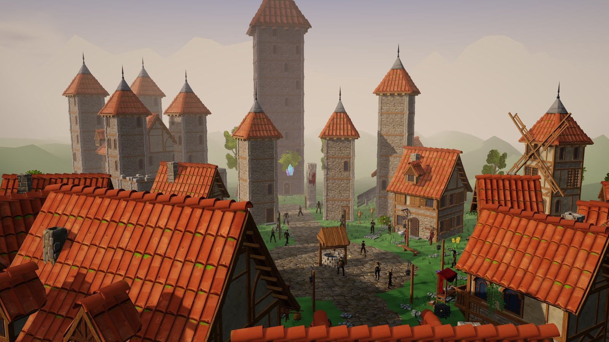
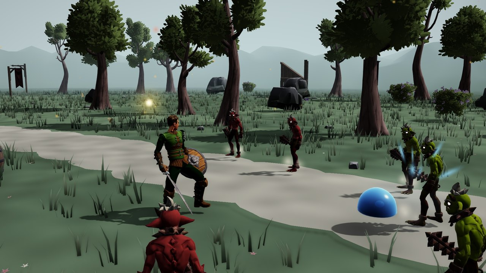
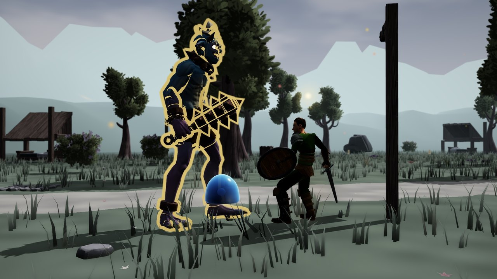
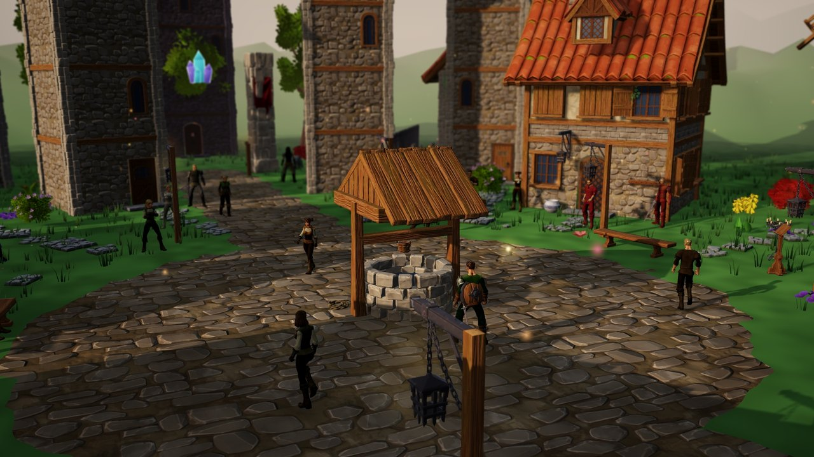
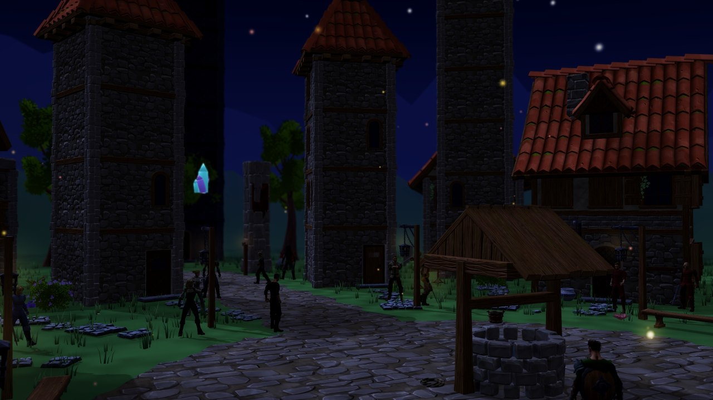
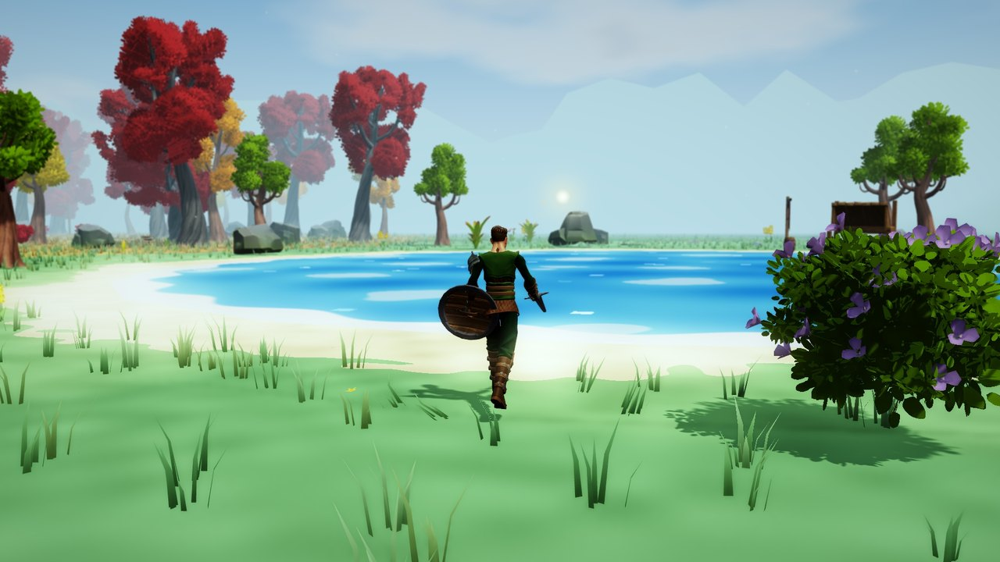
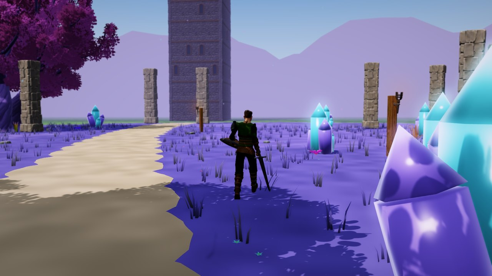
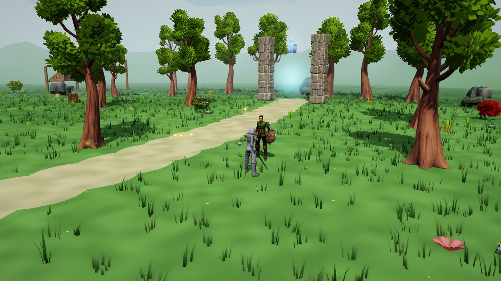
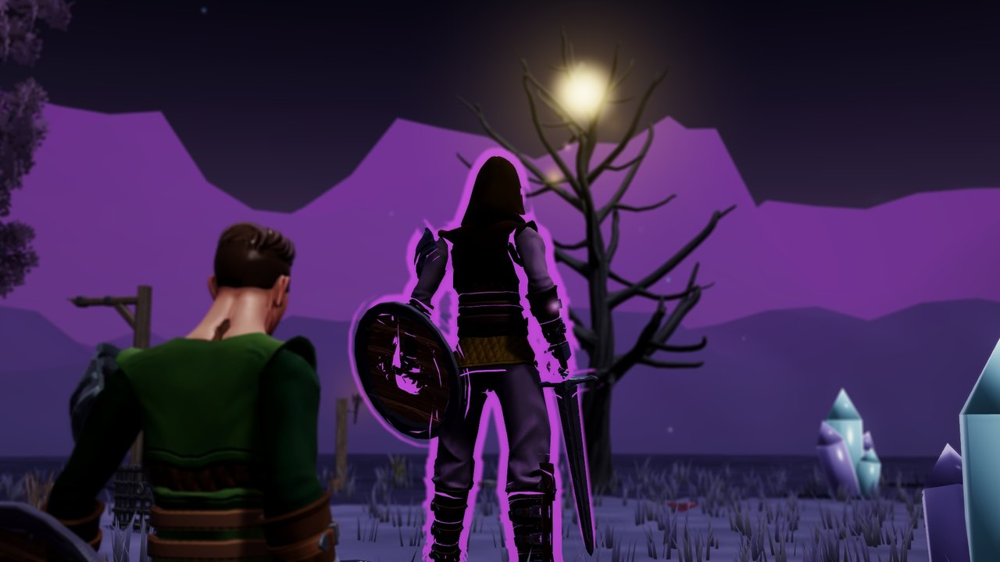

<div align="center">



# Greyspire

**A third-person action RPG about climbing a thirty-floor tower that drains the colour out of the world.**


[About](#about) · [Features](#features) · [Screenshots](#screenshots) · [Controls](#controls) · [Getting started](#getting-started) · [How it is built](#how-it-is-built) · [Testing](#testing) · [Credits](#credits)

</div>

---

## About

The Gloom Tower stands over the town of Brushwick, and the land around it is turning grey. The Painters who kept the colour in the world have been drained and carried up the tower. You climb it floor by floor, fight what lives inside, bring the Painters home and face the Gloom King at the top.

Between climbs you return to Brushwick, a town on a running day and night clock. Townspeople keep their own schedules, shops close at night, and the Painters' Guild posts commissions that send you out into the Wilds beyond the walls.

The entire world is assembled at run time from C#: one scene, one bootstrap object, and about 22,000 lines of game code that build the town, the tower floors, the Wilds, the characters and the interface.

## Features

**The climb**
- **30 tower floors**, weak to strong, each an explorable area with monster packs, chests, a healing spring and stairs that unseal only when the floor is clear.
- **Guardians** every fifth floor. Each one gives a permanent boon on its first defeat. Grol the Gatekeeper, the first, fights in his own arena with a three-move pattern, enraged phases and a checkpoint.
- **Branching floors**: floor 2 has an upper bridge and a lower crossing; floor 4 asks you to make a choice that the town remembers later.
- **Progress is earned, never skipped.** The tower opens strictly floor by floor. Experience comes only from fights and commissions, and a fall costs half your carried Sparks, never a floor.

**Combat**
- Four fighting styles: **sword and shield, great axe, light blade, and bare hands and focus**. Each has its own combos, reach, guard (shield block, axe-haft guard or quick deflect) and parry timing.
- Stamina, guard, parry, dodge, heavy attacks, throws and lock-on.
- **Enemies that fight together.** An encounter director gives them roles, so attackers take turns while the others flank, guard or throw.
- **Mop**, a gel companion, takes four orders: follow, assist, hold and solo.

**The world**
- Brushwick with a living clock: dawn, dusk, lit windows, a night watch and townspeople who keep their own schedules.
- **The Wilds**: ten regions outside the walls, each with its own colour and danger, with bandit camps and monster dens.
- Five drained Painters to rescue, with **Timeline-driven** rescue scenes that can play out two ways.
- NavMesh baked at run time, so enemies and Mop find their way around a world that is generated, not saved.

**Growth and saves**
- Levels, four stats (STR, AGI, VIT, SENSE), skills at levels 2, 4, 6, 9 and 12, Guardian boons and a town respec.
- A crash-safe save system: rewards cannot be lost or claimed twice, even if the game is closed mid-reward.

**Controls and access**
- 13 actions that can be rebound on both keyboard and controller, with full controller play.
- Hold or toggle for guard and sprint, an optional timing assist, a combat-focus HUD, and a journal.

**Look and sound**
- Hand-written shaders: smooth-lit `Toon` with normal and ORM maps, procedural `Sky`, `Water`, the jelly `Gel`, and a `Post` pass with ambient occlusion, grade and grain.
- Music that follows the fight, ambient sound beds, and wind-up sounds that warn you before an enemy strikes.

## Screenshots

<table>
  <tr>
    <td></td>
    <td></td>
  </tr>
  <tr>
    <td align="center"><sub>A mixed fight on the road</sub></td>
    <td align="center"><sub>A Guardian, outlined when enraged</sub></td>
  </tr>
  <tr>
    <td></td>
    <td></td>
  </tr>
  <tr>
    <td align="center"><sub>Brushwick's square by day</sub></td>
    <td align="center"><sub>The same streets at night</sub></td>
  </tr>
  <tr>
    <td></td>
    <td></td>
  </tr>
  <tr>
    <td align="center"><sub>The Wilds</sub></td>
    <td align="center"><sub>A land the tower has drained</sub></td>
  </tr>
  <tr>
    <td></td>
    <td></td>
  </tr>
  <tr>
    <td align="center"><sub>Colour comes back to a cleared land</sub></td>
    <td align="center"><sub>The top of the tower</sub></td>
  </tr>
</table>

<sub>All pictures were rendered by the game itself through its in-engine film rig (`Tools/cine.ps1`), without the HUD.</sub>

## Controls

| Action | Keyboard and mouse | Controller |
|---|---|---|
| Move / camera | `W A S D` / mouse | Left stick / right stick |
| Attack | Left mouse or `J` | X / Square |
| Heavy attack | `R` | Right trigger |
| Block / parry | `C` | Left trigger |
| Dash / sprint | Right mouse or `Left Shift` | B / Circle |
| Jump | `Space` | A / Cross |
| Throw | `G` | D-pad up |
| Burst | `Q` | Right bumper |
| Wave | `F` | Left bumper |
| Interact | `E` | Y / Triangle |
| Lock on | `T` | Right stick click |
| Status | `Tab` | D-pad down |
| Map | `M` | View / Select |
| Order Mop | `H` | Left stick click |
| Pause | `Esc` | Menu / Start |

Every key and button from Attack to Order Mop can be rebound in **Settings → Controls**. Movement, the mouse buttons, menus and pause stay fixed, so a binding can never lock you out.

## Getting started

### Requirements

- Windows 10 or 11
- [Unity Hub](https://unity.com/download) with Unity **6000.5.4f1** (Windows Build Support is included)
- [Python 3.10+](https://www.python.org/downloads/) for the asset scripts
- Optional: [Blender 5.2](https://www.blender.org/download/) to edit the `.blend` models

### 1. Clone

```bash
git clone https://github.com/pranavpanchal1326/Greyspire.git
```

### 2. Add the two monster models

The Imp and Puglin come from Quaternius' [Bestiary - Dungeon Monsters Kit](https://quaternius.itch.io/bestiary-dungeon-monsters-kit). Its licence allows the models in a game but not in a public repository, so they are downloaded rather than committed. **Do this before you open the project in Unity.** Their import settings are already committed, and Unity deletes import settings whose files are missing.

```bash
python Tools/fetch_packs.py itch
```

```bash
python Tools/install_monsters.py
```

If you downloaded the kit yourself, pass its folder instead: `python Tools/install_monsters.py "path/to/Bestiary - Dungeon Monsters Kit[Standard]"`.

### 3. Open and play

1. In Unity Hub choose **Add → Add project from disk** and select the cloned folder. The first import takes a few minutes.
2. Open `Assets/Scenes/Main.unity`.
3. Press **Play**. The bootstrap builds the title screen, the town and everything else.

### 4. Build the game

Use the menu **Greyspire → Build Windows Game**. The game is written to `Builds/Greyspire/Greyspire.exe`.

The same build from a terminal:

```bash
"C:\Program Files\Unity\Hub\Editor\6000.5.4f1\Editor\Unity.exe" -batchmode -quit -projectPath . -executeMethod BuildGame.Windows
```

The built game accepts `-shot <file.png> <seconds>` to save a screenshot and quit, which is handy for quick checks.

## How it is built

```
Main.unity
 └─ Bootstrap ──► Game                     the state machine: title, town, Wilds, tower, story, results
                   ├─ Village / VillageWorks   houses, towers, well, windmill, church, castle from a modular kit
                   ├─ GameHub · GameClock · GameLife · Resident     the town and its day
                   ├─ GameWilds                 ten regions, camps and dens
                   ├─ GameTower · GameFloors · FloorCatalog · GameBranch   the thirty floors
                   ├─ PlayerController · PlayerMoves · CharAnim · LimbPlacement   the hero
                   ├─ Enemy · EnemyRoles · EncounterDirector · EnemyGuardian      the opposition
                   ├─ Companion · NavField · NavFollower                          Mop and pathfinding
                   ├─ Story · StoryScene · GameStory                              rescues and Timelines
                   ├─ Save · JourneyStore · SaveRewards · SaveObjectives          the save system
                   └─ GameUI · UI · Bindings · Access · GameJournal               the interface
```

| Folder | What is in it |
|---|---|
| `Assets/Scripts` | 101 game scripts, about 21,700 lines |
| `Assets/Editor` | 40 editor scripts: importers, the build, the film rig and the test suites (about 11,500 lines) |
| `Assets/Resources` | Models, animations, textures, audio and the six shaders, loaded by name at run time |
| `Blender` | Source `.blend` files for the models made for this game (slimes, Lumi, crystals, weapons and more) |
| `Tools` | PowerShell and Python: asset fetchers, model and audio builders, test runners, the film rig |
| `Reports` | Data the test suites write: balance tables, encounter logs, frame timings, acceptance records |
| `docs` | Design and engineering notes: the upgrade masterplan, an art guide and one report per production phase |

Humanoid clips are imported without baked root motion, so every move plays in place and the code drives position. Gaits are authored and measured by `Assets/Editor/GaitAuthoring.cs` so feet do not slide.

## Testing

The game is checked by automated suites that run the real game in the Unity editor, drive it with scripted input, and assert on the result. Together they make **more than 1,500 checks**: saves, combat contact, terrain and navigation, growth and balance, objectives, controller and comfort settings, branching floors, weapons, enemy roles, the Guardian, the companion, animation, environment and audio, and a 10-minute soak test.

Each suite has its own runner in `Tools`, for example:

```bash
powershell -NoProfile -ExecutionPolicy Bypass -File Tools/savetest.ps1
```

`Tools/verify-phase-nine.ps1` runs all of them against a mirror copy of the project, so your own editor can stay open. The runners expect Unity at the default Unity Hub path for 6000.5.4f1. Frame-timing checks need the machine on mains power.

## Documentation

| Document | Covers |
|---|---|
| [Upgrade masterplan](docs/GREYSPIRE_UPGRADE_MASTERPLAN.md) | The audit, the production gates and the full backlog |
| [First-zone art guide](docs/GREYSPIRE_FIRST_ZONE_ART_GUIDE.md) | Palette, materials and dressing rules |
| [Phase 1: save safety](docs/GREYSPIRE_SAVE_SAFETY_PHASE_ONE.md) | Rewards that survive any interruption |
| [Phase 2: combat contact](docs/GREYSPIRE_CONTACT_SAFETY_PHASE_TWO.md) | Hits, projectiles and guard rules |
| [Phase 3: terrain](docs/GREYSPIRE_TERRAIN_SAFETY_PHASE_THREE.md) | Ground support and navigation |
| [Phase 4: growth](docs/GREYSPIRE_GROWTH_SAFETY_PHASE_FOUR.md) | Bounded stats and balance |
| [Phase 5: objectives](docs/GREYSPIRE_OBJECTIVE_SAFETY_PHASE_FIVE.md) | Quests and consequences |
| [Phase 6: feedback and control](docs/GREYSPIRE_FEEDBACK_CONTROL_PHASE_SIX.md) | Cues, controller and comfort |
| [Phase 7: production](docs/GREYSPIRE_PRODUCTION_PHASE_SEVEN.md) | Reproducible runs and the soak test |
| [Phase 8: branching pilot](docs/GREYSPIRE_BRANCHING_PILOT_PHASE_EIGHT.md) | The branched floor 3 |
| [Phase 9: upgraded chapter](docs/GREYSPIRE_UPGRADED_CHAPTER_PHASE_NINE.md) | Weapons, roles, Guardian, companion, access, animation |

## Credits

Built with free assets from **Quaternius** (humans, outfits, animation, monsters, props, nature and village kits), **Kenney** (sound effects and jingles) and **cynicmusic** (music). The game's own models, shaders and code were made for it. The full list, with links and licences, is in [CREDITS.md](CREDITS.md).

## License

The original code, shaders, tools and models in this repository are © Pranav Panchal, all rights reserved. Third-party assets keep their own licences as listed in [CREDITS.md](CREDITS.md). The Bestiary monster files are not included and must be downloaded from their author.
