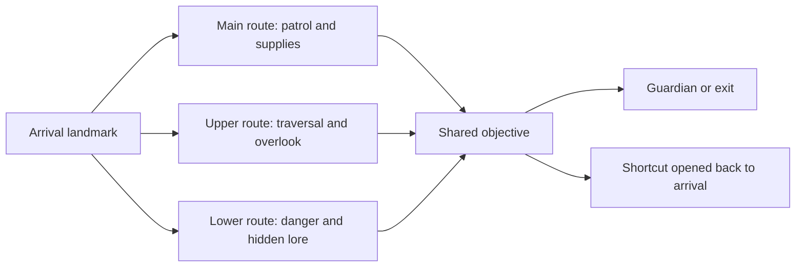
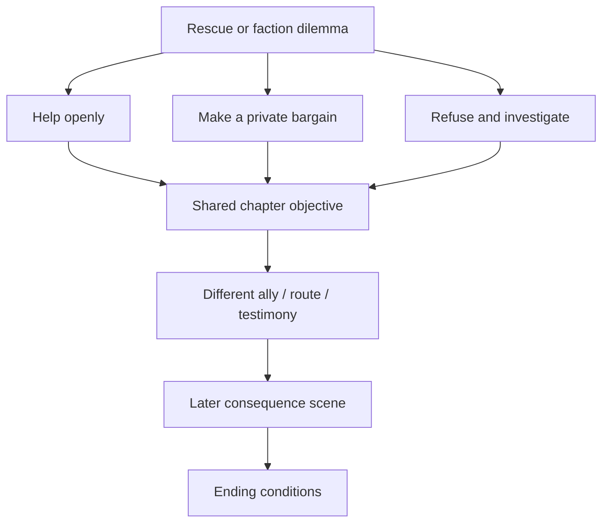

# Greyspire — complete upgrade master plan

**Date:** 12 October 2026  
**Scope:** movement, animation, combat, terrain and route branches, skill trees, story branches, unpredictable encounters, presentation, and production quality.  
**Primary project:** `D:\game`, Unity 6000.5.4f1.  
**Status:** phases one through eight / G0–G7 are closed for their recorded contracts. Phase eight passed 1,050 technical checks, a 618.8-second soak and the final Windows build; the user reported the required human pilot acceptance on 16 October. Phase nine / G8 has begun with the floor-2 route package; the full P1 chapter gate remains open. See [the phase-nine report](GREYSPIRE_UPGRADED_CHAPTER_PHASE_NINE.md), [the phase-eight report](GREYSPIRE_BRANCHING_PILOT_PHASE_EIGHT.md), [the phase-seven closure audit](GREYSPIRE_PHASE_SEVEN_CLOSURE_AUDIT.md) and the dated verification sections at the end. A planned feature is not a shipped feature.

**Save/reward phase one:** implementation and interruption coverage are recorded in [the phase-one delivery report](GREYSPIRE_SAVE_SAFETY_PHASE_ONE.md). Sections 23–40 preserve the original deep-audit evidence; the report distinguishes repaired behavior, conservative legacy migration, and the remaining content-ID prerequisites.

**Gates G0–G2:** phase-one save/reward safety, phase-two contact safety, and phase-three terrain/support/navigation are implemented and validated in sections 41–43. The final combined run passed 252 assertions plus both rescue branches and the tower navigation scenario; the Windows build succeeded with 0 errors and 1 existing warning. See [the phase-three report](GREYSPIRE_TERRAIN_SAFETY_PHASE_THREE.md) for the contract and authoring limits.

**Deep-audit revision:** the source-level review in sections 23–40 expands and corrects this plan. Start with [the deeper findings](#23-deeper-audit-evidence-and-severity), [reward integrity](#25-reward-integrity-and-interruption-safe-progress), and [the revised implementation order](#39-revised-implementation-order-and-deliverables). The 28 passing checks in section 21 apply to the earlier controller pass; they do not validate the new findings or implement the expanded roadmap.

## 1. The game we are aiming to make

A responsive dark-fantasy action RPG about a weak climber growing into someone powerful enough to change the tower and the town beneath it. Exploring a floor should involve choosing a route, reading danger, discovering something worth remembering, and returning with consequences. Combat should reward movement, timing, and build choices. The town should make those victories matter.

“1000/10” is the ambition: make the game exceptional in its own identity. The practical standard is a game that feels good immediately, stays interesting, respects the player's time, and works reliably. More features alone will not achieve that.

Combine the requested directions through clear roles:

- **Responsive movement:** quick steering, reliable braking, predictable jumps, forgiving input timing.
- **Weight in combat:** readable anticipation, convincing contact, deliberate heavy attacks, useful recovery windows.
- **Polished presentation:** coherent assets, strong silhouettes, clear sound, restrained effects, legible interfaces.
- **Unpredictable exploration:** varied encounters, routes, events, and discoveries inside fair, learnable rules.
- **Branches with consequences:** terrain, skills, and story offer different experiences rather than different labels for the same result.

The existing town, rescues, permanent tower progress, earned growth, and System awakening are useful foundations. Preserve them while improving their execution.

## 2. What is actually lacking

This assessment comes from the current source, project configuration, and an existing gameplay screenshot. It is not a measured frame-rate benchmark or a claim that every floor has been reviewed visually.

| Area | Current evidence | Why it limits quality | Required upgrade |
|---|---|---|---|
| Movement | `PlayerController.cs` uses direct acceleration and rotation rules | Starts, stops, reversals, and collision response need a consistent feel | Tune acceleration, braking, air steering, slopes, steps, and input timing as one system |
| Animation | `CharAnim.cs` blends existing gaits and weapon clips | Original movement feeding the blend was intended velocity; directional combat clips are limited | Use actual displacement, then author backsteps, strafes, turns, and planted contacts |
| Combat timing | Short light-combo timers drive damage separately from animation playback | A hit can feel disconnected from the visible blade | Define anticipation, contact, recovery, and cancel rules per weapon |
| Camera | Original obstruction logic only accepts certain collider types and keeps a 4.6 m minimum | A close wall can still stand between camera and hero | Test the full boom, including shoulder offset, and allow closer obstruction recovery |
| Targeting | Nearest-target and view-cone assistance, no explicit lock | Crowds can pull attacks toward an unintended threat | Visible target selection, lock, switch, occlusion rules, and consistent attack/throw targeting |
| Floor identity | `GameFloors.cs` builds a flat circular floor, a northbound path, packs, and stairs | Different prop sets can still produce the same play experience | Authored topology, elevation, loops, landmarks, branches, and different objectives |
| Floor objective | Stairs generally open when every enemy is dead | Completion can turn into searching for the last survivor | Mix objective types; preserve an intelligible reason for each gate |
| Surprise | Fixed layout seeds plus randomized pack composition/offsets | Randomness does not itself create interesting decisions | A bounded encounter director with event history and reproducible seeds |
| Progression | Four stats, level-unlocked skills, forge perks, Guardian boons | Numerical growth can outweigh build identity | Branching mastery with new actions, tradeoffs, and build-specific rewards |
| Story | Rescues already use Timeline, dialogue, and choices | Local choices need broader, visible consequences | Persistent consequence flags, town reactions, companion responses, and chapter callbacks |
| World | Runtime-built scenery, residents, clock, and region systems | Density and schedules need stronger player-facing meaning | Distinct places, useful services, environmental stories, and stateful events |
| UI | HUD contains health, level, currency, quests, clock, style, skill slots, and banners | Important combat information competes with many persistent elements | Contextual display, controller prompts, clear hierarchy, and accessibility controls |
| Audio | Existing SFX and music infrastructure | Footsteps, weapon material, enemy intention, and space need richer feedback | Surface-aware footsteps, layered contact audio, spatial ambience, and adaptive music |
| Engineering | Large partial `Game` class, registry-backed `PlayerPrefs`, automated scripts | More content will increase coupling and save risk | Data-driven definitions, versioned saves, isolated tests, reproducible builds, and performance budgets |

There is already duelist AI, attack crowd limits, guard-breaking, parries, multiple move types, story choices, and playtest logging. Extend those systems rather than describe them as absent.

## 3. Quality rules every feature must pass

1. The player understands the danger before the consequence.
2. Input intent survives a short recovery window; stale input expires.
3. Movement, animation, sound, and effects agree on what happened.
4. Every major branch changes a decision, tactic, reward, or consequence.
5. Mandatory content remains reachable with a basic build.
6. A surprise can change the situation; it cannot silently change the controls or hit rules.
7. Important progress is safe across death, restart, and save migration.
8. A feature earns its screen space, frame time, and production cost.
9. New content uses a shared art, audio, and terminology guide.
10. Expansion follows evidence from a polished playable chapter.

## 4. Movement and traversal

### Immediate controller quality

- Separate acceleration from braking. Reverse direction strongly enough to feel responsive without instantly sliding the body into another pose.
- Retain analog input magnitude and normalize diagonal movement.
- Tune walking, jogging, sprinting, guard movement, and air control separately.
- Measure actual horizontal travel after collision resolution. Use it for gait speed and footsteps.
- Cancel upward velocity on ceiling contact. Prevent repeated ground contact from granting extra ground jumps during ascent.
- Keep coyote time and buffered landing jumps. Prevent interaction gestures and committed actions from starting unintended jumps.
- Reset velocity, targeting, visual lean, and buffered input on revive and scene arrival.
- Test at 30, 60, and 120 fps and with frame spikes; frame-rate independence is a requirement, not an assumption.

### Traversal expansion

| Feature | Player value | Design constraint | Priority |
|---|---|---|---|
| Steep-slope handling | Understandable terrain movement | Surface behavior and animation must agree | P1 |
| Step-up and stair polish | Smooth everyday traversal | No snapping through walls or unsupported ledges | P1 |
| Low vault and mantle | Opens useful shortcuts | Tagged or validated surfaces; camera and collision tests | P2 |
| Ledge recovery | Makes exploration less brittle | Generous capture bounds with clear eligibility | P2 |
| Ladders / authored climbs | Supports vertical routes | Entry, exit, interruption, and save rules | P2 |
| Contextual crouch | Adds stealth and low passages | Build encounters that actually use it | P2 |
| Sprint slide | Distinct movement/combat option | Existing slide gets entrance/exit and collision polish | P1 |
| Air control and System jump | Satisfying traversal identity | Double jump must fit the fiction and level reachability | P1 |
| Water wading | Makes flooded strata distinct | Speed, sound, effects, and enemy behavior change together | P2 |
| Advanced traversal powers | Late-game route reinterpretation | No skipping mandatory floor progression | P3 |

Avoid adding wall-running, unrestricted climbing, swimming, mounts, and parkour together. Each changes level design and multiplies collision and animation work. Add a traversal verb when a finished route demonstrates its value.

**Movement acceptance:** no walking animation against a solid wall; no uncommanded drift after braking; no jump duplication; no ceiling float; no slide through closed geometry; no permanent loss of control after an interruption.

## 5. Animation production

### Required animation set

- Idle variations: relaxed, threatened, guarding, exhausted, wounded, carrying, and conversation.
- Walk, jog, and sprint with matched ground speeds and synchronized gait phases.
- Starts, stops, 90°/180° turns, quick reversals, and acceleration poses.
- Combat movement: forward, backward, left/right strafe, diagonal combinations, guard movement.
- Jump anticipation, takeoff, ascent, apex/fall, soft landing, hard landing, and recovery.
- Dodge forward/back/left/right, with movement distance matched to the pose.
- Each weapon's light chain, heavy wind-up/release, recovery, running attack, aerial attack, guard, parry, riposte, and hit reactions.
- Context actions: chest, door, ladder, vault, pickup, drink, revive, assist companion.
- Emotional beats for principal characters: attention, refusal, fear, relief, grief, and restrained celebration.

### Technical pipeline

1. Standardize rigs, scale, avatar mapping, weapon sockets, and reference poses.
2. Put clip timing, ground speed, contact windows, and root displacement into metadata.
3. Choose movement ownership per action: controller-driven locomotion; authored displacement for actions that require it. Prevent root-motion and controller movement from both applying the same travel.
4. Build a directional locomotion mixer once suitable clips exist. Unity's directional blend options support forward/back/side directions, with freeform directional blending supporting multiple speeds in the same direction. [Unity 2D blend documentation](https://docs.unity3d.com/6000.0/Documentation/Manual/BlendTree-2DBlending.html).
5. Layer weapon actions and guard poses over compatible locomotion. Use full-body commitment for moves that need the hips and feet.
6. Add foot placement and pelvis adjustment after verifying gait speed. IK cannot repair fundamentally mismatched animation.
7. Add bounded aim/look adjustments and hand IK for weapons and interaction targets.
8. Add secondary cape, hair, and equipment motion within a tested performance budget.
9. Review every weapon from the gameplay camera and from side/front views.

**Current limitation:** the first pass can reverse an existing walk for backing away. Dedicated backward and lateral clips still need production. This is an interim improvement, not complete directional combat animation.

**Animation acceptance:** planted feet remain stable within a measured tolerance; weapons stay gripped; hits occur during visible contact; transitions avoid snapping or crossed feet; pausing, skipping a scene, dying, and reloading always return animation ownership correctly.

## 6. Combat depth and feel

### Combat contract

Every attack definition should contain: animation, anticipation, active contact window, recovery, damage, reach, arc, displacement, stagger, resource cost, permitted cancels, sound, effects, and camera response.

- Keep fast light attacks and deliberate heavy attacks. Weight comes from anticipation, contact, reaction, and sound, not delayed steering everywhere.
- Use short, expiring buffers for attack, heavy, throw, and dodge. Hold one follow-up rather than accumulating a whole chain.
- Make defensive cancellation explicit. Let a light swing dodge out after contact; keep heavy commitment meaningful.
- Validate hits across a contact window or swept blade volume. Record already-hit targets per swing to prevent repeated damage.
- Respect cover, height, teams, invulnerability, and guard direction.
- Preserve parry, guard-break, launcher, plunge, dash stab, throw, and riposte; improve consistency before adding more verbs.
- Give each enemy a readable stagger/poise policy. Ordinary enemies and Guardians should react differently for a reason.
- Make attack assistance directional. Respect a locked target without snapping to an unrelated enemy behind the player.

### Weapon identities

| Weapon | Identity | Tradeoff | Example mastery |
|---|---|---|---|
| Sword and shield | Reliable dueling and defense | Less burst damage | Parry follow-up, shield displacement, counter stance |
| Great axe | Wide, committed impact | Longer recovery and exposure | Cleave, armor break, charged execution |
| Light blade | Mobility, precision, weak points | Small reach and fragile guard | Evade counter, marked strike, repositioning |
| Spear | Spacing and lanes | Vulnerable when crowded | Brace, advancing thrust, sweep |
| System focus | Control and ranged setup | Limited energy and interruption | Tether, wave shaping, delayed detonation |

Ship three polished weapon families before expanding the roster. A weapon must change spacing and choices, not just damage values.

### Resources and difficulty

Prototype stamina before adopting it globally. Use it if it improves attack/guard decisions; avoid making routine town travel tiring. Show costs, recovery delay, exhaustion, and regeneration clearly. Keep an accessibility option for hold/toggle actions and adjustable timing assistance. Difficulty should adjust known rules, aggression, and assistance rather than secretly alter player inputs.

**Combat acceptance:** damage matches contact; no duplicate damage per swing; a locked throw follows the chosen target; missed attacks have readable recovery; canceled attacks do not deal their old hit later; guard and parry timing can be learned.

## 7. Enemy intelligence and encounter design

### Different roles, not just bigger health bars

| Role | Behavior | Counterplay |
|---|---|---|
| Duelist | Feints, spacing, timed commitment | Read the committed strike; punish recovery |
| Shield carrier | Holds a lane and protects an ally | Heavy break, flank, displacement |
| Skirmisher | Repositions and strikes exposed flanks | Lock, intercept, control space |
| Artillery | Announces a shot and uses distance | Cover, close distance, interrupt |
| Support / caller | Strengthens or summons nearby threats | Prioritize the caller; disrupt the signal |
| Ambusher | Hides within readable environmental cues | Observe, bait, use detection tools |
| Heavy | Owns space with slow dangerous attacks | Dodge direction and commitment matter |
| Guardian | Distinct phase and arena interactions | Learn a small, coherent move language |

Expand the existing crowd attack limits into encounter coordination. Keep a bounded number of simultaneous damaging commitments, give waiting enemies useful repositioning, and prevent unseen synchronized attacks from becoming the default.

Enemy adaptation may remember recent tactics: a shield carrier can respond to repeated frontal lights; a skirmisher can stop repeating a punished approach. Adaptation must stay bounded and telegraphed. No invisible input reading or perfect counters to every player action.

### Guardian requirements

- One thematic mechanic and recognizable silhouette per Guardian.
- Anticipation signals that work through pose, audio, and effect shape.
- Escalating phases that remix learned moves before introducing new ones.
- Opportunities for each supported build to succeed.
- Arena cover/elevation that improves decisions without trapping the camera.
- Distinct victory aftermath, boon, and town reaction.
- Fast retry and a way to practice the mechanic without a long repeated run.

## 8. Unpredictability that stays fair

Build an encounter director that chooses from authored events. Keep important geography and progress stable; vary compatible situations inside it.

### Director data

Each event needs: stable ID, biome/floor tags, prerequisites, threat cost, reward cost, cooldown, exclusion tags, spawn sockets, warning cues, completion state, persistence rule, and fallback.

Use separate seed streams for geometry, encounters, loot, and cosmetic variation. Log those seeds. Changing a grass placement should not reroll a boss or story outcome. Persist chosen events when a floor is first entered so save/reload cannot repeatedly reroll rewards.

### Example event pool

| Event | Early signal | Choice | Consequence |
|---|---|---|---|
| Wounded climber | A voice and discarded equipment | Rescue, trade, investigate, pass | Companion affinity, supplies, or later testimony |
| Rival expedition | Fresh tracks and a campfire | Cooperate, race, negotiate | Different route access and faction reaction |
| Bell patrol | Audible bell before sight | Avoid, ambush, silence caller | Changes nearby encounter pressure |
| Failing bridge | Visible damage and creaking | Repair, detour, risk crossing | Route cost with a reachable fallback |
| Corrupted shrine | Altered light and readable inscription | Accept a stated bargain or refuse | Temporary modifier with explicit cost |
| Lost caravan | Wheel tracks and scattered cargo | Escort or recover supplies | Town service recovery or faction debt |
| Hidden chamber | Draft, marking, or unusual echo | Spend a key/resource or leave | Lore and build-specific side reward |
| Predator hunt | Carcasses and changing calls | Track, evade, trap | A rare encounter with preparation time |
| Storm / flood | Forecast, rising water, wind | Change route or seek shelter | Encounter mix and traversal change |
| Broken rescue attempt | Signs of another climber's failure | Help, salvage, follow clues | A later town conversation and altered commission |

### Fairness limits

- No spawning damaging threats inside the player, camera, or immediate safe arrival area.
- No instant unavoidable attack on spawning.
- No removing the only route, quest item, or essential service.
- No repeating the same rare event across adjacent floors.
- No combining modifiers that remove every viable counterplay option.
- Safe points and completed mandatory progress remain dependable.
- Re-entry and reload reproduce the agreed persistence behavior.

**Initial director target:** one optional event plus one compatible encounter variation on selected non-tutorial floors. Increase combinations after testing. Do not randomize every system simultaneously.

## 9. Terrain and route branches

### Replace repeated floor shape with authored topology

Each floor needs a landmark, a primary route, at least one meaningful optional route, a reconnecting loop or shortcut, and a view that helps the player orient themselves. Elevation should create combat and navigation decisions.

### Six strata, six experiences

| Stratum | Terrain and architecture | Route identity | Encounter / discovery identity |
|---|---|---|---|
| 1 — swallowed outskirts | Broken gardens, low ruins, uneven woodland | Road, ridge, buried passage | First expeditions, signs of loss, basic ambushes |
| 2 — flooded precinct | Canal steps, drowned halls, water channels | Dry upper walkways versus risky flooded spaces | Bells, water-level changes, drowned memories |
| 3 — abandoned bastion | Courtyards, parapets, guard rooms | Defensive lane, flank, unlocked gate loop | Shield formations, siege traces, rival climbers |
| 4 — ash works | Foundry ruins, slag, vents, soot | Heat timing, machinery access, maintenance tunnels | Resource bargains and exhausted workers |
| 5 — fractured archive | Vertical stacks, broken bridges, hidden records | Observation, traversal, knowledge-gated secrets | Conflicting accounts and System revelations |
| 6 — crown of the spire | Exposed ascent and intimate final chambers | Paths reflecting earlier decisions | Consequences, principal confrontations, endings |

These are proposed themes; settle names and fiction in the art/narrative guide before producing all assets.

### Terrain implementation

- Establish shared metrics: capsule width, stair rise, vault height, head clearance, dodge distance, combat space, and camera space.
- Use modular authored rooms and route sockets before large procedural terrain.
- Build matching visible terrain, collision, navigation, and occlusion geometry.
- Support height-aware pathfinding, links for climbs/jumps, and stateful doors/bridges.
- Separate gameplay collision from cosmetic foliage.
- Keep key routes readable using silhouettes, lighting, materials, sound, and landmark views.
- Put shortcuts under player control; opening one should feel like learning the place.
- Offer meaningful differences: faster but dangerous, safer but costly, secret but demanding, companion/faction-dependent.
- Validate every route with the least upgraded movement kit.

Do not turn a branch into a mandatory grind or an unmarked dead end. A blocked route should communicate what would open it, and an optional route should reward the decision to explore it.

## 10. Skill-tree and training branches

Keep baseline movement, basic attack, dodge, and readable defense available. Branches should deepen those actions instead of selling back basic controller quality.

### Proposed mastery trees

| Branch | Core fantasy | Early node | Mid node | Signature node | Tradeoff |
|---|---|---|---|---|---|
| Mobility | Control position | Better landing recovery | Evade counter | Linked reposition strike | Lower sustained defense |
| Duelist | Win through timing | Precision follow-up | Parry conversion | Marked riposte | Demands close spacing |
| Guardian | Hold space and protect | Guard stability | Ally interception | Counter stance | Slower committed offense |
| Breaker | Commit to impact | Charged timing reward | Armor disruption | Ground-breaking cleave | Longer exposure on misses |
| System / Ember | Shape encounters | Wave control | Tether or delayed charge | Burst specialization | Energy and setup requirements |
| Hunter / Scout | Read and exploit the world | Tracks and weak-point clues | Trap/reposition synergy | Prepared ambush | Less raw frontal strength |

Companion bonds can add a small secondary branch, such as an assist or rescue ability. Keep these distinct from the principal combat trees so recruiting a companion does not invalidate a solo build.

### Training design

- Training grounds in town with a sparring partner, timing targets, moving targets, and traversal trials.
- Short exercises teach parry, guard break, spacing, and each weapon's signature action.
- Show timing/contact feedback and allow immediate retry.
- Offer demonstrations with clear input prompts.
- Training milestones unlock technique options or cosmetic mastery, not unlimited farmable stat power.
- Weapon mastery grows through varied meaningful use; repeated trivial actions have diminishing or no credit.

### Progression rules

- Preview prerequisites, effect, cost, and restrictions before spending.
- Use stable node IDs and save-version migration.
- Offer respec at town/checkpoints with a clearly stated, bounded cost.
- Preserve learned knowledge and story progress when respecing.
- Test three viable early builds and avoid mandatory damage nodes.
- Separate stat points, skill points, weapon mastery, Guardian boons, and faction reputation so each has a clear purpose.
- Keep a small number of signature choices. Hundreds of percentage nodes would dilute the system.
- Reserve strong synergies for combinations that create new behavior, such as parry into tether or guard break into a companion assist.

## 11. Story branches, factions, and companions

### Branch structure

Use branching scenes that reconnect into a manageable chapter spine. Preserve consequences as flags and changed encounters, services, relationships, or information. Avoid writing a separate full campaign for every dialogue choice.

### Consequence ledger

Each consequential choice needs:

- A stable choice ID and explicit persistent state.
- What the player knows before choosing.
- Immediate response from the character/world.
- A later callback, with a named scene or gameplay event.
- A compatible alternate path if the player refuses.
- Quest failure/abandonment/reload handling.
- A test covering both choices and a prior-save migration.

### Example branches

| Decision | Immediate result | Later result |
|---|---|---|
| Rescue a climber or secure a rare reliquary first | Rescue timing and resources differ | Trust, testimony, or a difficult later request |
| Give evidence to the Guild or a noble house | Payment, protection, and access differ | Patrol support, route privileges, and opposition |
| Keep or return a rescued person's memory | Different dialogue and reward | Companion affinity and a specific town scene |
| Use a powerful System bargain | Strength now with a disclosed cost | Narrative strain and a changed confrontation |
| Spare a rival after a duel | Lost immediate loot or gained cooperation | A rival assist, betrayal with clues, or negotiation |
| Rebuild a town service or fund an expedition | Local recovery versus tower resources | Shop availability, resident routine, and route preparation |

Exact outcomes must fit the existing fiction. Do not force the player to harm someone to obtain the only mechanically viable build.

### Companions

- Give each rescued companion a role, personal problem, home routine, and distinct response to the tower.
- Improve following through doors, route branches, vertical links, and combat spacing.
- Keep companions clear of the player's camera and dodge path.
- Add simple commands: follow, hold, focus, assist, retreat.
- Make affinity depend on visible decisions and personal quests.
- Add a small number of coordinated combat assists with recognizable cooldowns.
- Support solo play and companion recovery; avoid repeated escort softlocks.

### Narrative presentation

Use environmental clues, short dialogue, and changed world state before adding exposition. Important revelations need earlier setup. Major decisions deserve readable stakes and an interruption-safe scene. Track seen dialogue so the town can react without repeating the same speech on every visit.

## 12. Town, quests, exploration, and economy

- Expand the existing day/night schedules into useful routines: work, meals, visiting rescued people, and reacting to weather/events.
- Provide alternatives when an essential shop is closed. The clock should enrich the town rather than block the next session.
- Make growth visible in repaired streets, occupied homes, new services, changed crowds, and returning residents.
- Give important buildings usable interiors and a recognizable function.
- Replace some kill-count commissions with investigation, retrieval, negotiation, rescue, defense, and route discovery.
- Tie quest directions to landmarks, journal entries, and contextual map updates.
- Add discoverable lore with practical meaning: enemy weakness, route history, a person to ask, or an ending clue.
- Use loot categories with clear purpose. Avoid bags full of interchangeable low-value items.
- Keep crafting compact: repairs/upgrades, a few meaningful recipes, transparent ingredients, and a useful preview.
- Add supply choices before an expedition: healing, scouting, utility, and a limited preparation resource.
- Model prices/reputation with bounded authored changes. A full simulated economy is unnecessary until it creates a proven gameplay benefit.
- Keep permanent floor progress and earned growth clear after death. State the loss rule before the player risks resources.

## 13. Art direction and visual upgrade

### Resolve style before asset quantity

The current project mixes realistic humanoids with stylized scenery and creatures. Choose a consistent finish for Greyspire: grounded proportions, expressive readable silhouettes, and a restrained fantasy palette.

Create an art guide containing palette, roughness/material examples, character proportions, lighting, UI typography, effect intensity, and reference images owned or licensed for use. Review every imported asset against it.

### Environment

- Replace flat-disc ground appearance with believable surface transitions, slope, erosion, mud, wetness, roots, and worn paths.
- Build dense focal areas and quieter supporting space. Detail should guide attention rather than fill every meter.
- Add material age: soot, wear, moss, broken plaster, rust, and repaired stone.
- Give every stratum a silhouette language and a signature landmark.
- Use controlled fog, ambient light, shadow depth, and practical sources.
- Make night readable; supply lights and sound cues rather than crushing visibility.
- Add weather only when it supports route/encounter design and a measured rendering budget.

### Characters and effects

- Improve principal faces, skin/hair/cloth consistency, gear fit, silhouettes, and weapon grips.
- Add visible equipment progression where assets permit it.
- Use injury/reaction animation before increasing screen flash.
- Give player attacks, enemy threats, support effects, and objectives different visual shapes.
- Keep the System effect language consistent and reserve its strongest treatment for significant moments.
- Scale hitstop, shake, trails, particles, and screen effects together; effects must not hide the next danger.

**Renderer decision:** profile the existing pipeline and define the target style before migrating. Evaluate URP/HDRP with a representative scene, target hardware, asset conversion estimate, and measured frame cost. Do not merge the two projects or promise visual improvement merely from changing the pipeline.

## 14. Audio and music

| Layer | Upgrade | Acceptance |
|---|---|---|
| Movement | Stone, soil, wood, water, and metal footsteps; cloth and gear | Speed/contact match; no footfalls while stopped against a wall |
| Weapons | Swing, contact, shield, armor, stagger, and kill layers | A hit, block, miss, and heavy strike sound different |
| Enemies | Intention sounds, distance cues, phase changes | Important threats remain readable off-screen |
| Environment | Wind, interiors, water, distant town/tower activity | Space has identity without constant loudness |
| Music | Exploration, tension, combat, Guardian phase, aftermath | Transitions respond smoothly and do not restart constantly |
| Dialogue | Consistent recording/processing or a coherent text-led approach | Intelligible speech, subtitles, skip/replay support |
| Mixing | Separate buses, priority, attenuation, ducking, limits | Critical cues survive busy fights without clipping |

Keep source and license records for every asset. Review any generated asset policy against the actual intended release platform when preparing release. Asset availability, commercial rights, and platform rules need verification at that time.

## 15. UI, camera, accessibility, and onboarding

### Camera

- Preserve free orbit and readable lock-on framing.
- Smoothly follow actual velocity with bounded look-ahead.
- Check walls, foliage trunks, props, and shoulder offset; ignore character/trigger collisions appropriately.
- Recover gently after an obstruction or scene cut.
- Frame large enemies and vertical fights without hiding the hero.
- Let the player change FOV, sensitivity, inversion, shoulder preference, camera-motion strength, and automatic recentering.

### Interface

- Establish a hierarchy: survival and current danger first; current objective second; background progression/context last.
- Collapse nonessential information outside its useful context.
- Show target state, resources, cooldowns, and status effects clearly.
- Make branch previews and consequences readable before committing.
- Add controller navigation, focus behavior, input-specific prompts, and reconnection handling.
- Move complex menus toward maintainable layout components after establishing the design; current IMGUI can support the immediate prototype.
- Add a journal for objectives, discoveries, people, route clues, and remembered choices.

### Accessibility and onboarding

- Rebind gameplay and menu controls; save and restore overrides. The installed Input System supports interactive rebinding and JSON binding overrides. [Unity Input System bindings](https://docs.unity3d.com/Packages/com.unity.inputsystem@1.19/manual/ActionBindings.html).
- Support subtitle size, background, speaker label, and dialogue speed.
- Add hold/toggle options, vibration strength, motion reduction, and flash reduction.
- Communicate danger through shape and audio as well as color.
- Provide difficulty assistance with clear descriptions and reversible settings.
- Teach one action at a time in a safe context, then use it in a real encounter.
- Show why a locked route or unavailable ability is unavailable.
- Remove repeated tutorial interruption once the player demonstrates the action.

## 16. Engineering, saves, and performance

### Architecture

Extract new systems behind clear interfaces: movement motor, combat state, targeting, encounter director, quest/consequence state, progression, save service, and presentation. Keep the existing working flow during gradual extraction.

Use data definitions with stable IDs for attacks, enemies, skill nodes, events, items, quests, and dialogue. Store content references safely. Avoid putting every future system into the growing `Game` partial class.

### Save system

- Introduce versioned structured saves for expanded branch state.
- Keep user settings separate from journey state.
- Write atomically using a temporary file and backup; validate before replacing the last good save.
- Migrate existing PlayerPrefs progress without losing floor, rescue, boon, or quest data.
- Persist event choices, route state, faction consequences, mastery, equipment, and companion state.
- Handle corrupt/missing saves with recovery and a clear message.
- Test death, quit during transition, interrupted write, old save, and respec.

### Performance targets

Initial target: stable 60 fps at 1080p on the agreed reference PC. This is a production target, not a measured result. A 60 fps frame has about 16.7 ms total; CPU and GPU work overlap and must be measured independently.

- Record frame-time distributions, CPU/GPU bottlenecks, allocations, memory use, scene load time, and shader stalls.
- Profile a development player on the target hardware; editor measurements can be distorted by the editor's own work. [Unity profiling workflow](https://docs.unity3d.com/2022.2/Documentation/Manual/profiler-profiling-applications.html).
- Use LOD, culling, instancing, sensible shadows, texture budgets, and pooled combat effects where measurements justify them.
- Avoid hot-path allocations and repeated hierarchy searches; cache relevant components.
- Bound navigation, director work, active agents, lights, and effect counts.
- Stage loading/generation; avoid large synchronous work during combat.
- Offer graphics settings that meaningfully reduce the expensive systems.
- Measure the densest fight and town view, not only a quiet empty floor.

## 17. First upgraded chapter: the production proof

Build a compact, replayable first chapter before applying every proposal to all 30 floors.

| Segment | Purpose | Required proof |
|---|---|---|
| Town and training | Establish identity and teach controls | One useful service, one training encounter, one visible resident reaction |
| Floor 1 | Movement, contact, awakening | Reliable basic controls, clear first threat, strong System moment |
| Floor 2 | First route choice | Upper/lower path with different risk and a reconnecting shortcut |
| Floor 3 | First build choice | A mastery node changes a tactic; enemies reveal the difference |
| Floor 4 | Rescue and consequence | A branch changes a later scene/service/assist, with persistent state |
| Floor 5 | Guardian and payoff | Distinct boss mechanic, meaningful boon, town aftermath |

Add one bounded surprise event and one secret worth discussing. Provide a fast replay path to the Guardian and training encounter.

**Chapter gate:** a new player can learn, choose, recover from failure, explain the danger, and identify something memorable. Only then expand the content model.

## 18. Prioritized production backlog

Priority: **P0** foundation/blocker, **P1** first-chapter requirement, **P2** next expansion, **P3** optional after evidence. Effort: **S** contained code work, **M** cross-system work, **L** substantial content/asset work, **XL** major production. Effort labels are relative, not delivery-date promises.

| ID | Deliverable | Priority | Effort | Depends on | Definition of done |
|---|---|---|---|---|---|
| F01 | Controller and state-reset pass | P0 | M | Baseline | Collision, jump, brake, pause, revive tests pass |
| F02 | Lock and consistent targeting | P0 | M | F01 | Select/switch/death/occlusion/transition behave correctly |
| F03 | Camera collision and comfort | P0 | M | F01 | Tight walls tested; comfort controls saved |
| F04 | Attack timing and buffer contract | P0 | M | F01 | Contact/cancel/recovery tests and visual review pass |
| F05 | Versioned save and migration | P0 | M | Stable IDs | Old progress and new branch state survive interruptions |
| F06 | Performance baseline | P0 | S | Representative build | Player captures and bottleneck list recorded |
| A01 | Directional gait asset set | P1 | L | Rig standard | Back/side/turn/start/stop clips reviewed in game |
| A02 | Foot/hand placement | P1 | M | A01 | Contact and grip meet a measured tolerance |
| C01 | Three distinct weapon families | P1 | L | F04, A01 | Each changes spacing and has complete feedback |
| C02 | Coordinated enemy roles | P1 | M | C01 | Mixed encounter remains readable and fair |
| C03 | First Guardian redesign | P1 | L | C01, C02 | Phase, arena, retry, boon, and aftermath complete |
| W01 | Authored branched floor kit | P1 | L | Movement metrics | Main/optional routes and shortcut are reachable |
| W02 | Elevation and navigation links | P1 | M | W01 | Hero, enemies, and companions use intended routes |
| W03 | Seeded event director | P1 | M | F05, W01 | One event pool works with cooldown/persistence/fallback |
| P01 | Small mastery-tree prototype | P1 | M | F05, C01 | Three viable builds, preview, training, and respec |
| N01 | Consequence ledger and chapter branch | P1 | M | F05 | Both branches have immediate and later effects |
| N02 | Companion role and assist | P1 | L | N01, W02 | Follow/hold/assist/solo behavior tested |
| V01 | Art/material guide and first-zone pass | P1 | L | Style decision | Assets and lighting read as one place |
| S01 | Movement/contact/ambience audio | P1 | M | C01, W01 | Critical cues survive a mixed fight |
| U01 | Contextual HUD and journal | P1 | M | P01, N01 | Essential information reads during action |
| U02 | Rebinding and controller menus | P1 | M | Input actions | Rebind/persist/reconnect/navigation tested |
| U03 | Accessibility and onboarding | P1 | M | U01, U02 | Core journey playable with assist/comfort settings |
| Q01 | First-chapter external playtest | P1 | M | Chapter gate | Recorded observations inform prioritized fixes |
| W04 | Remaining strata topology and events | P2 | XL | Q01 | Each stratum introduces a distinct experience |
| N03 | Faction arcs and companion quests | P2 | XL | N01, Q01 | Consequences remain coherent across chapters |
| P02 | Remaining mastery branches | P2 | L | P01, Q01 | New branches add viable play patterns |
| V02 | Weather, secondary motion, atmosphere | P2 | L | F06, V01 | Visual budget and gameplay value verified |
| T01 | Advanced traversal | P2 | L | W01, A01 | Adds useful routes without progression skips |
| X01 | Photo mode / challenges / cosmetics | P3 | M | Stable core | Adds replay/share value without core regression |

## 19. Build order and scope control

1. **Foundation gate:** movement, timing, targeting, camera, save safety, performance baseline.
2. **Combat gate:** directional assets, three weapon identities, mixed enemy encounter, one Guardian.
3. **World gate:** authored branched floor, navigation, one event pool, route persistence.
4. **Progression/story gate:** small mastery trees, training, one consequential rescue branch, one companion assist.
5. **Presentation gate:** first-zone visual guide, sound, interface, onboarding, accessibility.
6. **Chapter gate:** package the first five floors, test with new players, repair the worst issues.
7. **Expansion gate:** repeat proven content patterns across remaining strata with distinct mechanics and narrative consequences.
8. **Release gate:** compatibility, migration, performance, licensing/source records, packaging, and support readiness.

Within each gate, finish a reviewable playable result. Do not accumulate dozens of partially implemented systems.

Defer multiplayer, live-service progression, huge open worlds, unlimited procedural generation, mounts, full economy simulation, and cinematic-quality faces until the single-player core demonstrates a need and the asset/engineering budget exists.

### Production ownership and risk review

Think in accountable disciplines even if one person fills several roles. Game design owns verbs, encounter rules, and balance; animation owns rigs and contact; environment design owns route topology and metrics; technical art owns asset integration and rendering budgets; narrative owns consequence continuity; audio owns critical cues and mixing; UX owns readability and accessibility; engineering owns state, saves, tools, and builds; QA owns reproducible failures; production owns scope and acceptance gates.

| Production risk | Early warning | Response |
|---|---|---|
| Too many unfinished systems | A feature works only in isolation | Finish the chapter gate before another expansion |
| Conflicting style across two projects | Assets and terminology change without a guide | Keep Greyspire's production direction explicit; evaluate ports individually |
| Missing animation assets | Controller features rely on visibly wrong gaits | Schedule directional clips; constrain interim actions to available motion |
| Branch explosion | Every choice requires a separate level/campaign | Reconnect chapter paths and persist concise consequences |
| Save incompatibility | New content reuses existing IDs or assumptions | Version schemas and run migration/recovery tests |
| Procedural softlocks | An event blocks a required objective | Validate prerequisites/reachability and provide a fallback |
| Build imbalance | One branch is always the optimal choice | Test encounters with multiple viable early builds |
| Visual cost grows silently | Quiet scenes meet budget but busy fights stutter | Profile worst-case player builds before adding effects |
| Asset work exceeds capacity | A new mechanic requires many unbudgeted clips/props | Prototype with a small complete set, then estimate production |
| Busywork replaces discovery | Players repeat chores to reach interesting content | Remove friction and make rewards support meaningful decisions |

## 20. Validation and playtest scorecard

### Automated regression coverage

- Controller: accelerate/brake, walls, corners, slopes, stairs, ceiling, jump release, coyote, buffered landing jump.
- Combat: buffer expiry, single follow-up, cancel-before/after contact, cooldown, duplicate-hit prevention, guard/parry.
- Targeting: visible selection, left/right switch, death transfer, lost sight, distance, transition clear, throw direction.
- Camera: close wall, shoulder obstruction, recovery, large enemy, vertical encounter, cutscene return, comfort zero.
- Branches: route reachability, alternate objective, director seed replay, incompatible event rejection, reward persistence.
- Saves: legacy migration, corrupt file, interrupted write, all important flags, respec, reload during quest.
- Story: both choices, skipped Timeline, abandoned scene, resumed save, callback conditions, ending flags.

### Human review

Use fresh players as well as experienced players. Ask them to demonstrate controls, explain a threat, choose a route, build a character, and recover from defeat. Observe before offering help.

| Question | Evidence to record | Initial gate |
|---|---|---|
| Does movement obey intent? | Missed inputs, unwanted drift, wrong target | No recurring control failure |
| Is combat readable? | Death explanation, perceived unfair hits | Most failures trace to an understood action/cue |
| Are branches meaningful? | Route/build reasons and recall | Players can name a practical difference |
| Does surprise remain fair? | Warning noticed, options available | No unavoidable event failure |
| Does progression matter? | Tactic changed after a reward | At least one visible behavior change per build |
| Does the world matter? | Rescue/town consequence recall | A chapter consequence is noticed without explanation |
| Is the chapter memorable? | Unprompted moments recalled | More than scenery or currency remembered |
| Is performance stable? | Frame-time logs under repeatable load | Meets the agreed player-build budget |

These are design gates, not claimed survey results. Set sample size and numerical thresholds after a baseline round rather than inventing an audience rating.

## 21. First implementation on 12 October 2026

The initial code pass covers:

- Separate combat braking, stronger reversals, controlled turning, and controller step/slope settings.
- Actual horizontal displacement feeding animation speed, camera look-ahead, and distance-based footfalls.
- Ceiling-contact velocity handling and safer jump/action gating.
- Expiring attack/heavy/throw/dodge intent, defensive cancel windows, and a bounded queued light follow-up.
- More deliberate light-combo duration and contact timing.
- Lock-on, target switching, death transfer, occlusion release, directional aim assistance, and locked throws.
- A target reticle and control hint.
- Camera boom obstruction checks covering its shoulder offset and impact displacement.
- Saved FOV, camera-motion intensity, and vertical-look inversion controls.
- Reverse-walk fallback and gait foot-IK flags on humanoid clips.
- Revive/arrival/pause intent reset.

New code is in `Assets/Scripts/PlayerFeel.cs`; the surrounding controller, moves, input, animation, camera, settings, and HUD have corresponding changes. Pre-edit versions of those files are in `Backups/greyspire-upgrade-20261012` because the repository already had unrelated local work.

**Still proposed:** authored branched terrain, encounter director, skill-tree choices, faction consequence expansion, new animation assets, versioned saves, broad visual/audio overhaul, and full first-chapter production. The first pass does not implement these larger systems.

### Verification record

- Test runner: `Tools/feeltest.ps1` and `Assets/Editor/FeelTest.cs`.
- Test log: `Logs/feel.log`.
- Build log: `Logs/upgrade-build.log` when building through the runner.
- The runner snapshots and restores Greyspire's editor PlayerPrefs registry key; it keeps a recovery snapshot under `Backups`.
- **Results:** Unity compiled the first pass; **28 automated checks passed**. Covered ground settling, acceleration/braking, stopped movement against a wall, wall containment, held/released jump height, ceiling contact, a jump buffered before landing, dodge recovery buffering, throw-buffer expiry, camera obstruction/recovery, lock selection/switch/death/occlusion, sight-aware aim assistance, locked backstep speed/facing, locked throw targeting, pause/revive resets, available clips, reverse-gait phase wrapping, and return to town.
- **Windows build:** succeeded, 382 MB, **0 errors**, 1 existing serialization warning about `PlayerStats`. Output: `Builds/Greyspire/Greyspire.exe`.
- **Visual check:** `Logs/feel/town-camera.png` was rendered and inspected. The town/camera still use the current art assets; this is not the proposed visual overhaul.
- **Save protection:** the runner reported successful restoration of the editor save after the test.
- **Limits:** this run is a foundation regression check, not a full tower playthrough, new-player playtest, quantitative foot-sliding study, settings UI visual review, or target-hardware performance certification. Slopes, complex corners, controller reconnection, and the full branch systems require their own later checks.

## 22. The next concrete production task

**Revised after the deeper audit:** first make one-time rewards interruption-safe, define collision/contact outcomes, and remove the terrain assumptions described below. The existing controller checks are necessary but insufficient for branching world production.

Then build **one branched Floor 2** with an upper route, a dangerous lower route, a shortcut, one seeded optional event, and rewards supporting two mastery choices. Pair it with training and a later town reaction. That playable piece proves the systems together after their prerequisites are reliable.

## 23. Deeper audit: evidence and severity

The first revision described many desirable upgrades but did not sufficiently trace interruption points, hidden state, or assumptions shared across systems. This revision goes down to those dependencies.

### Evidence labels

- **C — confirmed code behavior:** directly visible in the inspected implementation. A code trace is evidence of the implementation, not proof that a player has encountered the failure.
- **R — reproduced:** observed in a specifically recorded runtime test. No new runtime reproductions were performed for this documentation revision.
- **H — hypothesis to measure:** plausible consequence, performance risk, exploit, or player-experience issue requiring a controlled test.
- **D — design proposal:** desired new behavior rather than a defect in an existing promise.

Priorities below mean **P0: repair before expanding dependent systems**, **P1: necessary for the upgraded chapter**, **P2: expansion requirement**, and **P3: optional**. A P0 prerequisite for vertical terrain is not a claim that the existing flat floor is currently unplayable.

### Source map for checking the findings

| Source | Relevant implementation |
|---|---|
| Game.cs — floor completion | `FloorCleared`, `ClearScenes`, floor progress, delayed boon selection |
| Game.cs — entry and quit | `EnterFloor`; `OnApplicationQuit` at line 152 |
| GameGuild.cs — payment | `TurnInMission`, `MissionKill`, commission identity |
| Save.cs — new game | Explicit key cleanup, indexed journey state |
| GameStory.cs — rescue choice | `rescueAsk` keys written after rescue progression |
| GameFloors.cs — rescue setup | Rescue saved before its staged choice completes |
| PlayerController.cs — contact | `Strike`, `Hit`, attack timers, damage reactions |
| PlayerMoves.cs — area attacks | `Slam`, `BrushWave`, `ColourBurst`, projected distance |
| Projectile.cs — movement | World ray plus actor checks at the moved end position |
| Enemy.cs — movement | Intended animation speed, steering, ground-height correction |
| Companion.cs — following | Target choice, no-nav straight-line fallback, automatic damage |
| Resident.cs | Direct walking to home/post without navigation routing |
| NavField.cs — baking | Synchronous bake, fixed collection height, temporary collider disable |
| NavFollower.cs — destination | Moving-goal repath and sampled destinations |
| GameTower.cs — progression | Multi-level rewards, skills, daily growth |
| CharAnim.cs — playback | Playback limits separate from gameplay attack speed |
| ToonKit.cs — SFX | Non-spatial sources, numbered takes, missing-asset silence |
| Music.cs — tracks | Recorded-track behavior and shared battle recording |
| Fx.cs — dash ghosts | Mesh baking and temporary objects per ghost |
| PlaytestLog.cs — inferred events | Enemy-count/health-difference inference |
| ThirdPersonCamera.cs — obstruction | Fixed-size query buffer and minimum safe distance |

These links point to the current inspected files. Refresh line references after implementation changes.

## 24. Forty deeper gaps and their required outcomes

The evidence column identifies what is established and what still needs testing. These are open findings/proposals; the earlier build does not resolve them.

| ID | Evidence / priority | Deeper gap and failure path | Required outcome and regression |
|---|---|---|---|
| DA01 | C / P0 | `FloorCleared` saves floor progress before delayed Guardian cards; restart normally advances to the next floor | Persist a pending boon entitlement; quit before cards, on cards, and during confirmation must still grant exactly one boon |
| DA02 | C / P0 | `TurnInMission` saves mission completion and Sparks before XP is granted by the dialogue callback | Commit the complete reward transaction independently of presentation; quit/reload/skip must neither lose nor duplicate XP |
| DA03 | C / P1 | A rescue saves the rescued mask and stat points before its later choice is written | Persist pending rescue scene/choice or an explicit default policy; interrupted rescue must remain narratively coherent |
| DA04 | C + H / P1 | Floor clear is permanent while an optional rescue may still be waiting there; the next run advances past that floor | Provide return access to cleared-floor optional content or a deliberate recovery path; do not permanently strand a rescue through quitting |
| DA05 | C / P1 | `Save.Wipe` clears listed keys and several indexed families, but does not clear `rescueAsk{who}` | Define journey-owned keys centrally; new game clears every choice while preserving settings |
| DA06 | C / P0 for content edits | Missions and regions use array positions as saved identity | Stable IDs plus migration; inserting/reordering content must not turn one completed objective into another |
| DA07 | C / P1 before large expansion | Several completion sets use integer bit masks | Replace or formally bound these sets before exceeding their capacity; test at and beyond the content limit |
| DA08 | C / P0 | Projectiles move an entire frame step and then test actor distance at the end | Sweep the actor hit volume across the whole segment; a high-speed shot at low fps must hit the same target |
| DA09 | C / P0 | The projectile world ray checks only the first hit; an Actor at that hit makes the obstruction condition false | Explicit filters and nearest eligible collision ordering; an ignored/friendly actor must not hide a wall behind it |
| DA10 | C / P0 for branched combat | Light/area attacks commonly flatten target displacement and lack a solid-world contact check | Height-aware, cover-aware attack volumes; enemies on another level or behind a wall are hit only by attacks designed to do so |
| DA11 | C / P1 | `Hit` returns no contact outcome; `Strike` increments landed count after it even if damage is rejected | Distinguish miss, block, parry, immune, damage, stagger, kill; validate combo/feedback/reward policy for each |
| DA12 | C + D / P1 | Player damage does not establish one explicit hurt/action-interruption state for all moves | Define per-attack armor and interruption rules; canceled actions cannot keep an old pending hit |
| DA13 | C / P0 for elevation | Enemy movement pushes an enemy above y=0.3 back toward y=0.1 to prevent stacking | Replace absolute-height correction with support-surface and anti-stacking logic; enemies stay on elevated walkways |
| DA14 | C / P0 for elevation | Pickups settle at y=0.5; companion fallback uses y=0.05; story stage origin is flattened | Ground sampling and local support references for all world participants; loot/pets/scenes work above and below the original floor |
| DA15 | C / P1 | Resident walking and no-nav pet following directly change transforms | Real navigation/collision or validated authored routes; residents and followers cannot cross a closed wall |
| DA16 | C + H / P1 | The pet selects the nearest enemy near the player without an engagement or visibility policy, and deals automatic damage | Companion permission/engagement rules; it cannot initiate an unwanted camp fight or strike through cover |
| DA17 | C / P0 for stacked terrain | Runtime NavMesh collection uses a six-meter-high volume and one agent type | Collection bounds and agent compatibility must match authored vertical geometry; validate small and large participants |
| DA18 | C + H / P1 | NavMesh is built synchronously and temporarily disabled colliders are restored after the call without a `finally` | Bake safely with restoration on failure, readiness state, measured budget, and staged/prebuilt navigation |
| DA19 | C / P1 | Stats can grow without consistent soft caps; critical chance can exceed 1 through accumulated additions | Define stacking, caps, overflow value, and UI; every rewarded point must have a useful, disclosed effect |
| DA20 | C / P1 | Gameplay attack duration shrinks with attack speed while clip playback is capped | Synchronize achievable contact rate and clip phase; high-agility/boon builds retain visible contact and readable transitions |
| DA21 | C / P1 | Multi-level XP awards three points per level, but announcements can say only +3 and retain only one newly unlocked skill | Queue an aggregated progression summary; large XP rewards show every earned point and skill correctly |
| DA22 | C + H / P1 | High style multiplies XP; growth then helps maintain high style | Measure the feedback loop and struggling-player pace; consider separating mastery/style rewards from essential leveling |
| DA23 | C / P1 | Floor `Harm` is added to damage after some guard/reaction classifications inspect the original amount | Damage category, actual health loss, reaction, and danger UI must describe the same attack |
| DA24 | C + H / P1 | Region-limited commission kills use the player's current `regionNow` | Bind objective eligibility to target/event identity; killing across a region boundary must follow a documented rule |
| DA25 | C / P1 | Chief jobs filter region, bandit flag, and Brute kind rather than the named target ID | Named-target commissions verify the requested entity; a different chief in the same region cannot substitute accidentally |
| DA26 | C + H / P1 | Normal quit banks carried coins; the delayed defeat sequence applies loss later | Persist pending defeat/expedition settlement; quitting in a death animation follows the same stated loss policy |
| DA27 | C + H / P1 | In-world daily quests give permanent stat points and rest can advance the in-world day | Model repeated rest/farm loops and decide intended limits; progression must remain balanced without chore farming |
| DA28 | C / P1 | Shared SFX voices are configured with `spatialBlend = 0` | Separate UI and world audio; an enemy cue needs position, attenuation, and an audibility policy |
| DA29 | C / P1 | Missing SFX are silently ignored; loading stops at the first missing numbered take | Asset validator with critical/warning/optional categories; critical signals cannot silently vanish through a file gap |
| DA30 | C / P1 | Recorded tracks use loudness change for intensity, and battle regions share the battle file | Actual authored transitions/stems and scene identity; do not describe volume-only behavior as a full adaptive score |
| DA31 | C + H / P1 | Dash ghosts bake meshes and create objects repeatedly | Profile worst-case dashing; pool/reuse or simplify only if measurements justify it; track peak live meshes and cleanup |
| DA32 | C / P1 before authored lighting | Game startup deletes found lights while rebuilding its own sun | Establish ownership of generated versus authored lights; a scene designer's lights must survive normal startup |
| DA33 | C + D / P1 | Time scale is owned by `Juice`, while subsystems choose different state/time gates | An explicit pause/time-domain contract; every actor, projectile, ambience, timer, and scene follows its intended clock |
| DA34 | C / P1 | Camera-motion zero affects camera shake/FOV/punch, while screen flash, impact, lines, and aberration use other paths | Separate camera-motion and flash/effect comfort policies; test zero settings during the strongest burst |
| DA35 | C / P1 | `NumberPressed` uses keyboard digits; story choices and boon picks also have mouse paths; control help remains keyboard oriented | Complete controller selection/focus and updated lock controls; every required choice works without keyboard/mouse |
| DA36 | C + H / P1 | Shared Unity random calls serve damage, AI, sounds, and visual variation | Independent gameplay/content/cosmetic random streams; adding a visual or SFX call must not change encounter outcomes |
| DA37 | C / P1 | Defeated final boss retains hp=0.01; basic `Dead` checks alone do not represent combat eligibility | Explicit alive/defeated/targetable states; all combat queries exclude a defeated actor consistently |
| DA38 | C + H / P1 | Camera uses a fixed-size sphere-cast buffer without the saturated-buffer policy used by target sight | Define a bounded fallback or layer reduction; dense obstruction results cannot silently omit the closest meaningful wall |
| DA39 | C / P1 | Telemetry infers kills from enemy-list shrinkage and hits from nonfatal health reduction | Log authoritative events; splitting enemies, silent despawns, lethal damage, and second wind must be classified accurately |
| DA40 | C / P1 before six strata | Current chapter arithmetic uses ten floors per chapter while the proposal uses six groups of five | Move layout/theme mapping into explicit floor definitions; preserve existing progress, rescues, Guardians, and story references |

### Measured asset fact

The audio inventory scan found 32 literal `ToonKit.Sfx` IDs referenced in the inspected scripts. Thirty-one had a first numbered take in `Assets/Resources/Audio`; `hover` had none. This does **not** mean combat audio is generally missing. It demonstrates the missing-file validation gap and an intentionally optional candidate. Dynamic sound IDs and actual mixing still need separate review.

## 25. Reward integrity and interruption-safe progress

### 25.1 Guardian boon: the missed failure window

Current source sequence: final enemy dies → floor is marked cleared and saved → delayed clear scene → possibly dialogue → first-clear Guardian cards → selected boon saved.

Restart entry uses the cleared floor to choose the next one. There is no persistent pending-boon record in this sequence. That is the reason DA01 comes before new progression branches.

**Required sequence:** record floor completion and a stable pending reward ID together → present or defer reward UI → validate choice → grant the boon and mark the reward consumed together → show celebration. Resume pending rewards before normal next-floor entry.

The reward ID must identify campaign/run context, floor, and reward type. Re-showing a panel is safe; granting the same reward twice is not. Keep the originally offered choices or specify how a resumed offer is regenerated. Closing the program must not reroll a rare offer indefinitely.

### 25.2 Commission payment: separate state from dialogue

Current source sequence: mission complete flag and Sparks saved → thanks dialogue → callback grants XP. A dialogue callback is presentation flow, not a durable transaction boundary.

**Required:** one reward command validates the mission, grants its complete currency/XP/item/reputation package, marks completion, and records a receipt. The thanks scene reads that receipt. Skip, replay, localization failure, or a missing Timeline cannot change the reward.

### 25.3 Rescue state: progress, choice, and presentation are different

Store at least: rescue eligibility, rescue completed, rescue reward consumed, choice pending/resolved, chosen response, callback pending/delivered. Do not rely on one rescued bit to represent all six.

A rescued person may already be safe while their conversation remains unfinished. Provide a journal/town follow-up when a scene is interrupted. If the design uses a default answer, state and test that policy instead of inventing an answer silently during load.

### 25.4 Transaction invariants

- A reward has one stable identity and one consumed state.
- Inventory/currency/XP updates and completion belong to the same durable commit.
- Animation and dialogue never own the only copy of earned progress.
- Failure before commit gives no partial grant; failure after commit resumes presentation without a second grant.
- Old saves can recover missing entitlements from known completed milestones using a reviewed migration policy.
- Recovery must distinguish “earned but not selected” from “already selected”; guessing can duplicate boons.

**Interruption matrix:** stop before commit, between each state mutation, immediately after save, while cards are open, after button press, during dialogue, after skip, and during scene transition. Compare the final complete state, not just the displayed message.

## 26. The combat simulation needs a shared contract

### 26.1 Introduce an explicit hit result

A proposed `DamageRequest` carries attacker/source ID, target ID, action ID, contact position, direction, team, physical/magic category, health damage, poise damage, guard pressure, tags, and permitted penetration. A `HitResult` reports miss/block/parry/immune/damaged/staggered/killed and actual applied values.

Do not use mutable flags on the target as the long-term communication channel for crit/heavy status. A direct companion, projectile, reflected hit, or area effect must pass its own complete request. This also enables accurate sound, achievements, mastery, and telemetry.

### 26.2 Swept projectiles and weapon contact

Projectile collision should compare eligible world and actor hits along the traveled segment, with a radius appropriate to the shot. Ignore rules must be applied to all candidate collisions, then choose the nearest eligible result. Multi-hit attacks maintain a per-action hit set; penetrative attacks declare how many contacts and what materials they can cross.

Weapon contact uses the blade/attack volume during the active phase, including movement between frames. Use authored volumes where a literal blade sweep is unsuitable. Distinguish physical occlusion from intentional magical area penetration. Avoid a universal line-of-sight gate that accidentally weakens a spell intended to pass through thin cover.

### 26.3 Combat state and action ownership

Define a transition table for free, preparing, active, recovering, guarding, dodging, hurt, staggered, interacting, scene-controlled, and defeated states. Resource/cooldown changes, hit sets, target intent, animation ownership, and interruption behavior must enter/exit consistently.

| Situation | Required decision | Required test |
|---|---|---|
| Hurt during light wind-up | Interrupt, absorb, or partial cancel? | Old active window cannot fire after interruption |
| Hurt during heavy contact | Explicit armor window and cost | Same result at different frame rates |
| Dodge buffered during recovery | Earliest permitted exit | One dodge, no stale second action |
| Guard immediately after swing | Guard entry and parry eligibility | Recovery cannot be bypassed unintentionally |
| Burst during another move | Override, layer, or reject | No hidden double hit or lost resource |
| Interaction near an enemy | Allowed state and cancellation | Chest/door does not create accidental invulnerability |
| Player and last enemy die together | Settlement order | No lost floor, duplicate reward, or frozen result |
| Companion kills the last enemy | Attribution and progression | Floor/reward logic uses an actual kill event |

### 26.4 Threat, guard, and invulnerability

Separate damage magnitude from attack category. A modest base hit with a high-floor damage modifier remains the same move, but its actual damage and danger presentation must be intelligible. Guard break, unblockable, projectile, grab, area, and environmental categories need their own cues and policies.

Dodge safety needs start/end phases and source eligibility. Decide whether overlapping attacks can grant multiple “perfect” rewards, whether grace time is defensive safety or offensive cancel time, and how rapid-reset dodges affect encounter pressure. Demonstrate these rules in training.

### 26.5 Encounter action budgets

The existing simultaneous-attacker limit covers duelists, not every ranged, heavy, bomber, or Guardian action. Add an encounter-level commitment budget and off-screen threat policy. Track dangerous commitments and recovery opportunities, not merely enemy count.

**Acceptance:** mixed groups offer a readable response window; a ranged fan and several melee commitments cannot routinely become an unavoidable synchronized hit. Validate with slow, fragile, ranged, and companion-supported builds.

## 27. Elevation must work for the whole game

Adding hills is a system migration. The renderer, player, enemies, pet, residents, pickups, projectiles, navigation, quest spots, effects, and cutscenes all need the same meaning of “standing here.”

### Shared world-space services

Create bounded queries for support surface, local normal, walkable destination, region ownership, visibility, and safe spawn. Each returns success/failure and relevant surface identity. A caller must have a fallback when no support exists. Avoid silently assuming y=0.

| Participant | Replace | Required behavior |
|---|---|---|
| Enemy | Absolute ground-height correction | Stay on actual support; prevent stacking through collision/separation |
| Loot | Fixed-height bounce plane | Settle on stairs/bridges/terrain; recover inaccessible drops safely |
| Companion | Fixed y and direct fallback | Use validated route/support; recover behind the player at a safe socket |
| Resident | Unchecked line to nearest home door | Home ownership and traversable route; recognize blocked doors |
| Story actor | Stage origin flattened to zero | Stage on the local surface and validate departure route |
| Telegraph | Flat ring at an assumed floor height | Project onto valid surfaces or explicitly represent a volumetric area |
| Target query | Horizontal distance only | Account for relevant vertical separation and combat eligibility |
| Quest interaction | Bare point and distance | Validate approach space, view, support, and intended interaction range |
| NavMesh | Fixed-height volume | Include the required stacked geometry and supported agent sizes |
| Camera | Generic fixed minimum boom | Consider avatar geometry, near plane, obstruction thickness, and pivot placement |

### Terrain test course

Build a reusable greybox course containing uphill/downhill travel, convex and concave corners, narrow door, stair landing, overhead beam, bridge over a lower path, a moving/closing barrier, a missing ledge, and two actors on different levels.

Run player traversal, enemy chase, pet follow, resident route, loot drop, projectile flight, lock-on, melee contact, and one rescue scene through it. The bridge-over-path case is mandatory: it reveals height-aware hit and navigation mistakes that a flat test stage cannot.

### Route graph validity

Validate branch states as graph constraints: entry reaches exit; required objective can be reached; optional content can be recovered; shortcuts reconnect; doors have a legitimate open condition; no mutually exclusive choice blocks every mandatory path. Sample positions alone do not prove a complete route.

## 28. Animation depth beyond smoother blending

### Contact, biomechanics, and readability

- Measure foot-lock drift per support interval and gait, rather than judge one attractive screenshot.
- Distinguish pelvis travel, foot placement, body facing, aim facing, and weapon facing. Lock-on should not require every part to point at the same angle.
- Add direction-change anticipation and recoverable pivots; cap torso twist and do not make knees rotate unrealistically to compensate for missing strafes.
- Match dodge distance and contact height to its pose. A forward roll played while moving backward is an interim mismatch, not a completed directional dodge system.
- Give weapons weight through hip/shoulder movement, grip, recoil, and recovery. Do not add the same leaning effect to every action.
- Use action phase, not a free-running timer alone, for impact synchronization.
- Separate locomotion parameter smoothing from action-response latency; aggressive smoothing can hide an input delay.
- Author reactions for direction, severity, guard, posture, and body type within a bounded asset set.

### Extreme-build review

Review fastest legal attacks, slowest heavy weapon, largest movement bonus, longest reach, shortest dash cooldown, and maximum companion/effect density. Clip playback caps and growth curves must agree. If stats exceed the animation budget, use a visible alternate move or a disclosed soft cap rather than invisible damage acceleration.

### Animation deliverable ledger

For each clip, record asset source, rig/avatar, duration, usable phase, contact windows, ground speed/displacement, root-motion policy, blend compatibility, additive/mask requirements, supported body variants, and verification status. Missing clips must be caught by the build validator before a character silently uses an unrelated fallback.

Principal narrative characters also need attention hierarchy: chosen dialogue partner or locked threat takes precedence over a merely nearby character. Gaze, torso, camera, and dialogue framing should agree.

## 29. Progression mathematics and economy need simulation

### The missing balance model

Create a transparent model of base stats, level growth, allocation, forge perks, boons, weapon modifiers, crit expectation, armor/poise, cooldowns, enemy health, resources, drops, and repeatable rewards. Use actual implemented formulas as the baseline; declare each proposed change.

| Metric | Why it matters | Scenarios |
|---|---|---|
| Time to defeat an ordinary target | Pacing and hit significance | Starter, average, specialized, extreme builds |
| Actions before vulnerability | Defensive dominance | Guard-heavy, evade-heavy, ranged, companion |
| Damage received per mistake | Learning versus punishment | Floors around 16/26, different health builds |
| Effective health / recovery supply | Whether damage matters | Healing drops, level-up heal, second wind, retreat |
| XP per meaningful minute | Progression pace | Struggling/new player, expert style, farming |
| Reward value by source | Exploit and choice quality | Chest, commission, Guardian, daily, discovery |
| Currency inflow/outflow | Purchase decisions | Normal chapter, repeated expeditions, all upgrades |
| Branch payoff | Build identity | Each branch without ideal rare boons |

Do not balance only against an average damage number. Check variance and recovery: a rare crit can make a single fight look good while the ordinary experience remains slow.

### Specific formula reviews

- Critical probability needs a [0,1] interpretation and a stated overflow policy.
- Multiplicative damage boons compound; compare them to additive mobility/health choices over an entire chapter.
- Attack-speed growth must respect active/recovery and animation constraints.
- Movement growth must respect level metrics, camera, and authored jump/dodge reach.
- Reach growth must not bypass cover, elevation, or an entire boss spacing mechanic.
- Style XP must not turn early skill disparity into an excessive permanent power disparity.
- Repeated daily stat points require a budget and a clear relationship to in-world time.
- Level-up full healing changes encounter difficulty. Preserve it deliberately or revise it with an understandable alternative.
- Re-entering an expedition refreshes resources; model travel/reset farming before introducing scarcity.
- Second-wind stack counts, consumption, newly earned charges, rest, and reload need explicit semantics.

### Build quality requirements

Each mastery build needs a signature decision, a weakness, a normal reward path, and viable answers to mandatory encounters. A build should not require one randomly offered Epic to become functional. A bad allocation should have a recovery path without restarting the campaign.

Use encounter and reward simulations to identify outliers, then verify in gameplay. Simulation is a filter for bad options, not proof of fun.

## 30. Quest and faction state must become a real model

### Objective identity

Use stable quest/objective/target IDs and progress events. A kill event supplies victim identity, victim location/region, attacker/assist attribution, enemy tags, campaign state, and outcome. Do not infer named-target eligibility from an approximate enemy class and the player's region.

### Quest state graph

Suggested states: unavailable, offered, accepted, active, objective-complete, turn-in-available, reward-committed, presentation-pending, finished, failed, abandoned. Some quests may omit states, but transitions must still be explicit.

- Define retroactive completion for discoveries and milestones.
- Define what abandonment preserves and what it releases.
- Give mutually exclusive faction commitments a visible warning and recovery policy where appropriate.
- Persist task dependencies and fail-safe routes.
- Essential progression must survive unavailable NPCs, schedule changes, destroyed scenes, and rejected offers.
- Cross-region kills and shared encounters obey a documented rule.
- Quest text, journal, map, objectives, and rewards come from the same definition rather than drift apart.

### Faction simulation with visible consequences

Use a few understandable dimensions: trust, obligation, access, and hostility. A single universal reputation meter is often too blunt. A faction may trust the hero's skill while disliking a political choice.

Every faction consequence must produce something inspectable: dialogue, service policy, patrol presence, route access, ally behavior, a commission, or a later scene. Avoid numerical reputation with no observable effect.

**Branch coverage:** test refusal, betrayal, reparation, all-rescues and missed-rescue states, prior-save state, unavailable giver, and unfinished turn-in. No branch should erase an already committed reward.

## 31. Surprise needs memory, budgets, and pacing

### Persistent event memory

Track what the player has already encountered, recently heard, recently failed, and completed. A seed alone is not a pacing model. Use history to prevent repetition and to create delayed callbacks.

Distinguish four lifetimes: cosmetic per-frame variation, encounter-instance variation, expedition-persistent events, and campaign-persistent consequences. Save only the required state for each lifetime. Document reroll behavior before implementing it.

### Pacing director

Use bounded states such as arrival, exploration, rising tension, committed encounter, recovery, discovery, and transition. Inputs may include recent damage, threat exposure, available recovery, route choice, and encounter history. The director can choose a compatible event; it should not secretly weaken a boss mid-hit or spawn a counter to the player's current button press.

Build tension through early signs, delayed confirmation, choice, confrontation, relief, and consequence. Constant ambushes eliminate surprise by teaching the player to expect an ambush everywhere.

### Event compatibility rules

| Combination | Policy |
|---|---|
| Flood with the only exit bridge disabled | Reject unless a validated alternate route exists |
| Ambush immediately after a rescue scene | Require safe recovery and a readable cue |
| Elite caller plus repeated reinforcements | Bound active count and provide a clear interrupt |
| Storm hiding a mandatory projectile cue | Supply an alternate cue or reject the combination |
| Rival faction event after faction resolution | Match persistent consequence flags |
| Rare reward event during reload | Resume its selection and consumed state |
| Low recovery plus multiple mandatory encounters | Provide a known preparation/retry route; measure actual difficulty |

### Mystery versus confusion

Keep intentions mysterious while rules remain readable. A strange sound can hide who is approaching; it should still signal that attention matters. A hidden passage can reward observation; a required door should not depend on guessing an undocumented pixel.

## 32. World ecology and social behavior

Add purpose to the environment: food/storage, paths people use, damaged services, signs of previous expeditions, predators/prey where appropriate, and material/weather reactions. A populated area needs reasons for its inhabitants to stand there.

### Social simulation, bounded

- Residents belong to actual households and services, not simply the nearest visual door.
- Schedule changes have travel time and route validity.
- A conversation can reserve a character's attention; their departure policy should not fight the scene.
- Crowds yield to doors, the hero, and important interactions.
- Barks have speaker identity, topic history, significance, and repeat cooldown.
- Reactions prioritize the most meaningful recent event rather than a generic line triggered by proximity.
- Town growth changes useful space and behavior, not just building count.
- Essential services provide a fallback or a clear waiting/rest option.

### Environment interaction catalogue

Candidate verbs include opening, repairing, lowering, extinguishing, illuminating, moving, inspecting, listening, and using an item at a marked mechanism. Add a verb only with a complete affordance: appearance, approach space, prompt, animation, sound, effect, state persistence, failure feedback, and quest integration.

Do not require every visible prop to be interactive. Establish consistent material/object language so the player can distinguish scenery from opportunities without scanning every object for a prompt.

## 33. Companions need engagement, agency, and reliability

The current pet is a useful affectionate support system, but an invulnerable auto-attacker is not the complete companion design described in the earlier roadmap.

### Companion contract

- **Engagement:** engage a threat the player has chosen or that has committed aggression; optional proactive behavior is a setting/command.
- **Visibility/reach:** collision and attack volume rules apply to companions too.
- **Formation:** maintain a useful side/rear slot, avoid camera and dodge lanes, and reserve interaction space.
- **Recovery:** route failure has a timer and a safe recovery socket. Teleport behind the player only after validating support and visibility policy.
- **Attribution:** companion kills and assists generate proper combat and progression events.
- **Power:** support damage, control, and healing have explicit budgets. Do not make low-risk automatic damage dominate every build.
- **Personality:** combat decisions and bark topics fit the companion's identity.
- **Solo equivalence:** mandatory routes/quests remain possible when a companion is absent.

Human companions need a state model for recruited, following, assigned, scene-controlled, assisting, unavailable, and returned-home. Their relationship state and temporary gameplay state should not be the same variable.

**Required tests:** narrow door, closing door, bridge, elevator/climb transition if added, crowded boss, safe retreat, companion left on another floor, scene interruption, target death, player death, and load while assigned elsewhere.

## 34. Sound, comfort, and information accessibility

### World audio must carry information

Add position and semantic priority to world cues. A threat sound needs an origin and distance; UI acknowledgment normally does not. Listener-relative clarity, occlusion, reverberation, and voice limits should work together.

Validate source categories and required files in the asset pipeline. For numbered takes, either discover valid files independently or reject gaps clearly. Cache refresh belongs to content build/runtime policy rather than silent empty arrays that never recheck during an editing session.

### Full comfort controls

Separate camera motion, camera auto-correction, FOV pulses, flash intensity, impact-frame style, chromatic aberration, motion lines, vignette pulses, vibration, and sound dynamic range. Provide presets plus individual controls where useful. Document which effects remain at zero.

No critical cue may depend only on a flash, color, sound, vibration, or tiny text. Combine at least two useful channels for important threats. Reduced effects must retain readable impact and threat states.

### Controller completeness

Audit every screen and context: title, settings, forge, status, boon cards, dialogue advance, dialogue skip, story choice, map, journal, inventory, confirmations, ending choice, results, and recovery messages. Test focus entry, cycling, selection, cancellation, connection loss, and device switching.

Update control help from a shared action definition so the pause menu, tutorial, reticle, and journal cannot disagree after adding lock-on or rebinding. Distinguish deliberate whole-scene skip from advancing one line.

### Readability beyond visual style

Test low/high resolutions, common aspect ratios, font scaling, long localized strings, subtitles over bright/dark scenery, overlapping notifications, and a crowded fight. Numeric comparison panels need meaningful changes and tradeoffs rather than decorative arrows.

## 35. Performance, resource ownership, and release discipline

### Measure the full runtime, not code aesthetics

Record CPU/GPU frame time, p95/p99 frame time, long stalls, managed allocation, live native meshes/materials/textures, active voices, navigation jobs, and transition duration. A code pattern is a hypothesis until its actual cost is captured on the target machine.

### Ownership and lifecycle

- Generated objects know their owner and disposal policy.
- Authored lights are not deleted by a global startup sweep.
- Mesh/material/audio allocations have reuse or cleanup paths.
- Pool reset restores every state field, trail, collider, timer, target, and callback.
- Scene transitions cancel old actions safely and cannot leave live callbacks pointing at destroyed content.
- Background tasks validate that their owning scene/campaign is still current before applying results.
- Debug views/logging have explicit enable rules and release costs.
- Missing assets fail with actionable diagnostics or a reviewed graceful fallback.

### Representative stress scenarios

1. Fastest legal dash loop with a detailed hero and several weapon pieces.
2. Mixed ranged/melee encounter with support, telegraphs, hitstop, and companion.
3. Dense town at schedule change with barks, doors, lamps, and weather.
4. Repeated town↔floor↔Wilds transitions and rest cycles.
5. Long expedition with many pickups, corpses, and effects.
6. Resource-loading fallback and shader warm-up on a cold launch.
7. Large branch scene containing upper/lower routes and different agent sizes.

For dash ghosts specifically, check mesh baking time and the peak/count after recovery. If a pool is chosen, prove its bounded size and correct cleanup. Do not pool everything automatically without a measured need.

### Build/release gates

Use an identifiable build/version, content manifest, save schema, settings schema, seed policy, and compatibility matrix. Keep development diagnostics, gameplay data, and user progress separate. Test a clean install and an update from the previous build. A successful Unity build only proves packaging/compilation; it does not prove the campaign, performance, or save safety.

## 36. Telemetry must describe what actually happened

The existing logger is a helpful start but cannot serve as the authoritative balance dataset in its current event-inference form.

**Example:** a BigSlime death removes one enemy and spawns two. The list grows by one, so a kill logger using only list shrinkage misses that kill. Conversely, silent removal can shrink the list without a rewarded kill. Fatal damage is excluded from the current nonfatal health-change branch.

### Required event schema

Include event ID, sequence number, build/content version, session/expedition ID, floor/encounter ID, time domain, action/source/target IDs, seed references, result, relevant values, and reason. Use stable IDs rather than display names. Write events at the authoritative decision site.

| Event family | What to capture |
|---|---|
| Input/action | Intent, buffer, accept/reject/expire, state, latency |
| Contact/damage | Source, target, outcome, actual damage, guard/poise, action phase |
| Progress/reward | Entitlement, choice, commit, duplicate rejection, resume |
| Navigation | Destination, path status, blocked duration, recovery reason |
| Exploration | Route choice, discovery, objective eligibility, event seed |
| Story | Offered choice, resolved choice, skipped presentation, callback delivered |
| Economy | Source/sink ID and exact transaction delta |
| Performance | Scenario marker, frame-time spikes, allocations and relevant budgets |

Batch writes and flush on known boundaries with a bounded memory/disk policy. The existing full-file rewrite after each event should be measured in long sessions; do not assert it causes a stutter without a capture. Keep diagnostic collection opt-in, understandable, and local unless a separate data-sharing feature is requested.

## 37. Content tools that make the upgrade producible

### Required editor tools

| Tool | What it validates or enables | Why it matters |
|---|---|---|
| Attack phase editor | Contact, recovery, cancel, displacement preview | Designers can align a hit without changing scattered constants |
| Terrain route validator | Entry/objective/exit/shortcut connectivity by state | Branches do not softlock |
| Spawn-socket validator | Support, clearance, visibility, safe arrival distance | Surprise stays fair |
| Agent-size test | Different navigation and collision footprints | Large enemies and pets use suitable routes |
| Event compatibility editor | Requirements, exclusions, budgets, persistence | Director combinations remain bounded |
| Quest/consequence graph | Stable IDs, transitions, reward receipts, callbacks | Story branches remain testable |
| Skill-tree editor | Prerequisites, costs, caps, respec, build preview | Progression stays understandable |
| Asset completeness scan | Animation, sound, materials, sockets, source records | Missing content is caught before play |
| Save inspector/recovery test | Versions, pending transactions, migration | Progress can be audited without manual registry edits |
| Scenario runner | Fixed seeds, loadout, route, encounter, frame settings | Regressions are reproducible |

### Data ownership

Use one definition for each floor's stable ID, theme, layout, Guardian/rescue/objective references, navigation config, event sockets, music, and save scope. This replaces implicit arithmetic dependencies when moving from three ten-floor chapters to six five-floor strata.

Store display text separately from identity. Validate duplicate IDs, references to removed content, cycles in skill prerequisites, unreachable quest states, empty rewards, missing fallbacks, and incompatible event tags. Development tools should export a readable report into the project.

## 38. Experience design missing from a feature checklist

### Moment-to-moment loop

Observe → choose position/route → commit an action → see a clear result → adapt → recover → receive meaningful progress. Every system should help this loop. A large tree and a large map cannot compensate for an unclear hit or a dull decision.

### Session loop

Return to town → learn what changed → prepare with a useful choice → choose an expedition objective → explore/fight/discover → bank progress → see a consequence. The town should provide anticipation and payoff rather than become a long mandatory menu commute.

### Campaign loop

Each stratum adds one primary mechanical problem, a development in the System/people, a route reinterpretation, and an earned change in power. Later content recombines mastered verbs. Reusing an enemy is acceptable when the situation changes; changing only its health and color is insufficient.

### Emotional progression

Plan vulnerability, competence, temptation, consequence, mastery, and resolution. Match mechanical rewards to those beats. If the story calls the hero weak while the pet casually clears every fight, presentation and simulation disagree.

### Failure design

Explain what failed, what was lost, what was kept, and a practical next option. Reduce time from failure to a meaningful retry. Avoid repeating the same long arrival/scene/tutorial after the player has learned it. Death is only one failure type: retreat, failed bargain, missed investigation, or resource cost can create consequences without erasing the journey.

### Exploration value

A discovery can grant a new route, useful knowledge, a build option, a relationship change, a strange scene, or a preparation advantage. Not every secret needs currency. Preserve mystery with clue consistency and a journal that records evidence without immediately solving it.

### Deliberate restraint

Review each proposed feature against its player decision, production cost, test cost, and distinctiveness. Reject a feature that duplicates an existing decision without improving it. The “1000x” ambition should produce deeper, more coherent play, not an unfinishable list.

## 39. Revised implementation order and deliverables

This supersedes the earlier order where it conflicts. The first-pass controller work remains useful; new terrain/progression production must wait for the identified prerequisites.

| Gate | Deliverable | Open audit IDs | Demonstration required |
|---|---|---|---|
| G0 — protect the journey | Reward receipts, pending choices, settlement, new-game isolation, stable-ID migration plan | DA01–07, DA26 | Interrupt and resume every one-time reward without loss/duplication |
| G1 — trustworthy contact | Hit result, swept projectile/weapon policy, eligibility, hurt/guard contract | DA08–12, DA23, DA37 | Cover, low-fps shot, vertical target, interruption, mutual kill |
| G2 — coherent world coordinates | Support queries, elevation-safe actors/loot/story, navigation readiness | DA13–18 | Full terrain course with all participants |
| G3 — bounded growth | Stat caps/stacking, attack phase sync, complete reward summaries, balance model | DA19–22, DA27 | Extreme legal builds remain readable and viable |
| G4 — correct objectives | Target/event identity, quest transitions, consequence ledger | DA03–06, DA24–25 | Boundary kills, named chief, interrupted rescue, alternate branch |
| G5 — complete feedback/control | Spatial cue priorities, asset scan, adaptive-score proof, controller/comfort coverage | DA28–30, DA34–35 | Whole chapter on controller and reduced-effects settings |
| G6 — reproducible production | RNG separation, lifecycle ownership, telemetry events, stress captures, explicit floor definitions | DA31–33, DA36, DA38–40 | Replay seeds, repeated transitions, long session, source-linked report |
| G7 — branching pilot | One branched floor, small mastery choices, one event and consequence | Earlier W01/W03/P01/N01 | Routes, build identity, surprise, and later callback work together |
| G8 — upgraded chapter | Town/training plus floors 1–5 with Guardian payoff | Full P1 backlog | Fresh-player journey and all prior gates |
| G9 — expansion | Remaining strata, faction arcs, richer companions, advanced traversal | P2 backlog | Reuse proven tools; each stratum earns its mechanical identity |

### Work packages, not vague promises

For every package attach: owner discipline, concrete artifact, relevant source/data, dependencies, acceptance scenario, failure recovery, save impact, asset requirements, performance budget, and evidence of completion. A package marked done must be playable/reviewable rather than merely have code committed.

The earliest valuable implementation is **Guardian/commission reward integrity**, followed by **combat collision/contact**. The earliest valuable world proof is **the shared terrain test course**. These are more urgent than adding extra biomes or dozens of skill nodes.

## 40. Verification status of this deeper revision

**Completed in this revision:** inspected source across combat, projectiles, progression, saves, quests, rescues, AI/following, navigation, NPC schedules, audio, effects, camera, input, and telemetry; traced the open findings above; checked literal SFX asset availability; expanded and revised this Markdown document.

**Evidence limits:** findings marked C describe inspected code and inferred failure paths. They are not newly reproduced bugs, profiler measurements, surveyed player outcomes, or completed fixes. Findings marked H require the listed scenario tests. No new Unity runtime implementation or build was produced for this documentation revision; section 21 records the earlier first-pass implementation and its actual checks.

### Minimum evidence before claiming an upgraded system

- A source/data change linked to its requirement.
- A repeatable scenario proving the intended behavior.
- Interruption/load coverage when it changes durable state.
- Visual/audio review when it changes presentation.
- Worst-case budget capture when it increases recurring work.
- A human playtest when its success depends on comprehension, enjoyment, or a meaningful choice.

Keep this plan as a living production document. Resolve findings with dated evidence, revise priorities when tests reveal worse issues, and record decisions about intentionally retained behavior. Ambition becomes quality through that loop.

## 41. Save and reward phase one — 13 October 2026

The core G0 save/reward work is now implemented in the primary Greyspire project. The detailed delivery contract, migration decisions, save locations, source map, and remaining prerequisites are in [GREYSPIRE_SAVE_SAFETY_PHASE_ONE.md](GREYSPIRE_SAVE_SAFETY_PHASE_ONE.md).

| Audit finding | Current outcome |
|---|---|
| DA01 | Guardian clear and exact pending offer commit together; resume in town; boon/receipt commit once |
| DA02 | Complete commission currency/XP/level/points payment commits before thanks; callback replay does not pay |
| DA03 | Rescue reward and pending choice persist; chosen branch and presentation completion have separate durable state |
| DA04 | Tower gate recovery visit reaches missed rescues on liberated floors without advancing the active climb |
| DA05 | New game replaces the complete journey namespace, including choices/receipts; settings remain |
| DA06 | Commission IDs and frozen registry migration are implemented; region-ID migration is planned before reordering |
| DA07 | Existing mask families are formally bounded and checked; replacing all masks with stable-ID sets remains planned |
| DA26 | Defeat settles the saved purse before the timer; quit/reload/results cannot repeat settlement |

Evidence: **103 save/reward checks passed**, **28 movement/camera/input regression checks passed**, both Timeline rescue branches completed including cutscene skip, recovery gate screenshot inspected, and **Windows build succeeded (382 MB, 0 errors, 1 existing warning)**. Logs are `Logs/save-safety.log`, `Logs/feel.log`, `Logs/save-safety-story.log`, and `Logs/save-safety-build.log`.

The first write timing sample exposed redundant disk barriers. The final 100-transaction sample measured 14.23 ms median / 17.03 ms p95 on this machine; a kill now commits XP/commission/daily progress together. Synchronous event saves still need worst-case and target-hardware profiling.

Legacy data is imported conservatively: missing historical boon/commission-XP receipts cannot be inferred safely, so ambiguous historical payments are not automatically reissued. Atomic application-interruption checks and backup recovery are covered; physical power-loss testing and full campaign playtesting are not claimed. The remaining G1–G9 upgrade gates are still open.

Phase-one closure was re-audited before starting G1. That review found and repaired defeat-delay interaction/healing and stale-campaign backup recovery. The closure revision passed 103 safety checks, 28 movement checks, both rescue branches, and a 0-error Windows build. The campaign marker also prevents silent registry reimport when committed journey files are missing. The validated G0 source/evidence baseline is retained under `Backups/phase-one-complete-20261013`; the phase-one report records the exact scope and remaining expansion constraints.

## 42. Phase two — trustworthy combat contact, 13 October 2026

G1 began after the phase-one closure audit and passing 103/28/rescue/build evidence. The detailed implementation contract and collision/action policies are recorded in [GREYSPIRE_CONTACT_SAFETY_PHASE_TWO.md](GREYSPIRE_CONTACT_SAFETY_PHASE_TWO.md).

| Finding / gate | Implemented outcome |
|---|---|
| DA08–09 | Whole-segment actor capsule sweeps, relative actor translation, nearest swept solid ordering, initial overlap, and saturation fallback; ignored actors cannot hide a wall |
| DA10 | Vertical and cover eligibility on physical contact; explicit Brush Wave and Colour Burst magic policies |
| DA11 | Damage request/result, actual health loss, miss/immune/block/parry/kill/defeat/revival, and guard-break/stagger/launch flags; rejected damage earns no landed-hit credit |
| DA12 | Accepted hurt and skill overrides cancel old pending offensive contact and queued intent; immunity/guard retain their stated behaviors |
| DA23 | Heavy/light category remains independent of floor harm; result damage agrees with health loss and guard policy |
| DA37 | Defeated King remains for presentation but is combat-ineligible for damage, targeting, projectile and companion selection |
| G1 mutual kill | Guardian entitlement and one fall settlement survive both event orders; results callback remains live; final-boss mutual kill retains progress and returns to a rematch |

Initial delivery evidence: **56 contact checks**, **103 save/reward checks**, **28 movement/camera/input checks**, both Timeline rescue branches including skip, navigation route/follow/hunt scenario completion, and a **382 MB Windows build with 0 errors and 1 existing warning**. Before starting G2, a closure audit repaired shockwave frame crossings and projectile expiry/actor-motion clipping. The verified G1 baseline passed **63 contact + 103 save + 28 movement checks**, and another 0-error build. Closure evidence is retained under `Backups/phase-two-verified-20261013`; details are in the phase-two report.

G1 is closed for the current analytical contact policies. It does not claim continuous animated-blade mesh collision, arbitrary body deformation, a complete new terrain system, or a target-hardware performance certification. The next gate is G2: shared support/world-coordinate rules and the terrain course. Full region/rescue/hero ID migration remains required before content reordering/expansion.

## 43. Terrain and world-coordinate phase three — 13 October 2026

G2 began after the revised G1 closure passed. The implementation and evidence are recorded in [GREYSPIRE_TERRAIN_SAFETY_PHASE_THREE.md](GREYSPIRE_TERRAIN_SAFETY_PHASE_THREE.md).

| Finding / gate | Implemented outcome |
|---|---|
| DA13 | Local support, controller collision, compatible routes, and crowd separation replace absolute enemy height correction; elevated chase and crowd checks pass |
| DA14 | Swept loot collision/recovery, supported companion placement/travel, local rescue stage/departure, and projected ground markers preserve elevation |
| DA15 | Residents own home/post destinations and use complete routes or supported collision fallback; closed barrier stops travel and reopening resumes it |
| DA16 | Pet assistance requires an engaged, visible, eligible enemy and accepted contact; idle camps and covered enemies are preserved |
| DA17 | Root hierarchy geometry/bounds include stacked terrain; three conservative body profiles reject incompatible doors/clearance; sampling is anchored to local support |
| DA18 | Exact collider restoration on failure, explicit pending/readiness, asynchronous staged builds, cancellation/disposal, and elapsed bake evidence |
| G2 course | Bridge over lower route, hills, corners, narrow door, stairs, low beam, closing barrier, and missing ledge; all named participants exercised |

Final evidence: **58 terrain + 63 contact + 103 save/reward + 28 movement/camera/input = 252 passing assertions**, both rescue branches including skip, tower route/follow/hunt completion, and a **382 MB Windows build with 0 errors and 1 existing serialization warning**. Logs: `Logs/terrain.log`, `Logs/contact.log`, `Logs/save-safety.log`, `Logs/feel.log`, `Logs/terrain-story.log`, `Logs/terrain-nav.log`, and `Logs/terrain-build.log`. The course camera capture is `Logs/terrain-course.png`.

G2 is closed for the current bounded support/navigation contract and reusable terrain proof. Existing layouts and authored sockets are retained. New chapter branch/door/objective graphs, moving-platform attachment, content-ID migration, growth/animation/balance work, and hardware profiling remain later production requirements. The validated source/evidence baseline is `Backups/phase-three-complete-20261013`.

Before G3, phase-three closure repaired a long-frame dodge-buffer ordering gap and passed **58 terrain + 65 contact + 103 save + 28 movement = 254 checks**, followed by a 0-error Windows build. Its verified baseline is `Backups/phase-three-verified-20261013`; details are in the phase-three report.

## 44. Bounded-growth phase four — 13 October 2026

G3 is closed for the implementation and technical acceptance contract in [GREYSPIRE_GROWTH_SAFETY_PHASE_FOUR.md](GREYSPIRE_GROWTH_SAFETY_PHASE_FOUR.md). Existing earned records are retained while effective level/stat allocations are bounded at 60. Smooth damage/tempo/movement limits, critical overflow value, town respec and disclosed point/XP conversion preserve useful reward value. Offensive action time and full/upper/legacy clip playback share a bounded contact plan.

DA21 summaries include every point, rank and skill, queue in order and retain reading time under obscuring panels. Daily presentation follows the successful save commit. DA22 style rewards now pay carried Sparks rather than compound permanent XP; core struggling-player XP remains at the old D-style schedule. DA27 daily points stop after twenty per campaign, with currency continuing and no same-day replay.

Final evidence: **194 growth + 65 contact + 103 save + 28 movement + 58 terrain = 448 checks passed**, Status/summary captures inspected, and a **382 MB Windows build with 0 errors and 1 existing Post.shader warning**. The source, runners, model, logs, captures, compiled DLL and manifest are retained in `Backups/phase-four-complete-20261013`.

The runtime model exports 35 loadouts, 130 action plans, 3,780 encounter envelopes and 180 deterministic tower-pace rows. An initial 1.3–2.1 second extreme King damage budget prompted a smooth damage limit; the final legal extreme light-combo estimates are 6.51–7.25 seconds. The model documents excluded combat effects and is not a human balance/playability certification. [Results and assumptions](../Reports/growth-balance.md).

At the phase-four checkpoint, G4 — correct objective identities, quest transitions and consequences — was the next gate. Its subsequent closure is recorded below. Controller/comfort review, authored pose review, full progression playtests and hardware profiling remain separate production requirements.

## 45. Objective and consequence phase five — 14 October 2026

G4 is closed for the current contract in [GREYSPIRE_OBJECTIVE_SAFETY_PHASE_FIVE.md](GREYSPIRE_OBJECTIVE_SAFETY_PHASE_FIVE.md). Before starting, phase-four's 232 checkpoint files and runtime DLL were verified against their hashes, growth/save checks were freshly rerun (194 + 103), and the baseline was retained in `Backups/phase-four-verified-20261013`.

DA24 regional kills now use immutable enemy home-region IDs; DA25 named jobs require the exact target identity. Split children retain origin and birth tier. Quest acceptance, objective events, readiness and payment use durable mission identity with attempt/expedition fences and bounded deduplication. Replayed kill callbacks cannot duplicate ordinary rewards. Discovery and treasure ownership commit atomically with their rewards.

DA06 region/treasure/rescue/hero records migrate from frozen index tables to stable IDs. The save envelope advances to schema 2; exact pre-upgrade schema-1 JSON archives remain beside each journey, independent of rotating backups. Unknown fields/bits and earned progression are retained, and unsupported objective revisions fail safely. Older builds require a manual pre-upgrade restore, which reverts progress to that snapshot.

DA03 rescue choice and consequence commit together, return requires the matching campaign token, and DA04 cleared-floor recovery remains available. The actual rescued town NPC acknowledges the persisted safe-return or information branch. Additional factions/arcs and new rescued-character placements remain authored-content work.

Final evidence: **120 objective + 194 growth + 103 save + 65 contact + 28 movement + 58 terrain = 568 passing assertions**, both rescue Timeline branches including skip, inspected town-consequence capture, and a **382 MB Windows build with 0 errors and 0 warnings**. The report records logs, isolation, the migration fixture, compatibility limits and runtime DLL hash. The complete source/evidence checkpoint is `Backups/phase-five-complete-20261014` with a SHA256 manifest.

At the phase-five checkpoint, G5 / phase six — feedback, control, audio/asset and comfort coverage — was next. Its subsequent closure is recorded below. Full campaign playtesting, hardware profiling, new faction simulation and later production gates remain open.

## 46. Feedback, controller and comfort phase six — 14 October 2026

G5 is closed for the current technical contract in [GREYSPIRE_FEEDBACK_CONTROL_PHASE_SIX.md](GREYSPIRE_FEEDBACK_CONTROL_PHASE_SIX.md). The phase-five prerequisite was verified again before edits: **267 checkpoint files, zero hash mismatches**, matching runtime/editor sources and the unchanged delivered DLL hash.

DA28 world cues now carry emitter position, attenuation, semantic priority and geometry filtering. Twelve world voices reserve four for threats; four separate UI voices prevent acknowledgements from consuming that budget. DA29 uses a shared 33-ID catalog/build audit: 31 required recordings are present, hover/talk are explicitly optional, numbered gaps cannot hide later takes, and missing required assets fail the build.

DA30 battle environments use distinct paired bed/drive loops on a shared DSP clock with bar-scheduled scene crossfades. The recorded town theme remains. Generated previews demonstrate different musical material and measured unclipped source samples; completed orchestration or a human-certified mix is not claimed.

DA34 adds separate saved camera/auto-camera, flash, impact-frame, motion-line, aberration and vignette controls plus a reduced preset. Render gating removes selected active effects immediately. The strongest burst keeps its FOV steady and selected post effects at zero while retaining ordinary rings, threat timing and HUD.

DA35 production buttons/sliders/boons share controller focus, repeat, confirmation and cancellation. The funded Guardian reveal defaults to a boon, destructive confirmation defaults to keeping progress, and story skip cannot also interact with the world. Shared help matches actual bindings. Disconnect pauses roaming, reconnect retains pause, and save-attention screens suspend gameplay/flush input and provide a controller close action. The map suspends the fight and reading timers and presents an unobstructed legend/close control.

Final evidence: **178 feedback + 120 objective + 194 growth + 103 save + 65 contact + 28 movement + 58 terrain = 746 passing assertions**, both rescue Timeline branches including skip, inspected captures, audio inventory/previews and a **382 MB Windows build with 0 errors and 0 warnings**. The controller inventory covers 88 controls in 21 contexts. The live route exercises floors 1–5, real combat contact and mandatory rescue/Guardian callbacks with controller input and reduced effects; a disclosed enemy-cleanup fixture shortens encounters, so it is not a fresh-player difficulty certification.

The source/evidence/DLL checkpoint is `Backups/phase-six-complete-20261014` with SHA256 verification. The report records reproduction, save isolation, scope and remaining human/hardware/audio/localization requirements. At G5 closure, G6 / phase seven — reproducible production — was next. Its current implementation and acceptance status are recorded in [the phase-seven report](GREYSPIRE_PRODUCTION_PHASE_SEVEN.md).

## 47. Reproducible production phase seven — 15 October 2026

G6 is closed for the technical contract in [GREYSPIRE_PRODUCTION_PHASE_SEVEN.md](GREYSPIRE_PRODUCTION_PHASE_SEVEN.md). Before edits, 486 phase-six checkpoint hashes and the delivered runtime DLL were verified, with fresh feedback/save checks (178 + 103); the verified prerequisite remains in `Backups/phase-six-verified-20261014`.

DA31 bounds and reuses dash poses after measuring the original cost. DA32 preserves authored lights and explicitly owns generated native resources, including runtime static-batch meshes that initially leaked 103 meshes per cycle. DA33 establishes simulation/world/presentation clocks and holds real actors, callbacks, character graphs, Timeline and dialogue-controller poses through hard pause. DA36 persists a versioned root and transactional loot stream, separates gameplay from effects/audio, and derives invariant actor/split identities. DA38 completes saturated camera casts. DA39 logs authoritative contacts, committed rewards and lifecycle events with bounded, optional local CSV output. DA40 replaces chapter arithmetic with explicit thirty-floor definitions while preserving layouts, rescues, Guardians, story beats and the final arena seed.

Final evidence: **201 production + 103 save + 65 contact + 29 movement/input + 58 terrain + 194 growth + 120 objective + 178 feedback = 948 checks passed**, both rescue branches/skip, tower route/follow/hunt and inspected captures. The sustained local town fixture ran **610.2056 seconds / 47,007 rendered editor frames**, crossed the saved day boundary and retained bounded native resources. Eighteen construction/cleanup transitions had identical native counts after warm-up. Independent parsing verified 1,769 unique events, 1,200 stress probes, zero dropped events and thirty floor definitions.

The final Windows build is **382 MB, 0 errors, 0 warnings**. The 494,592-byte runtime DLL has SHA256 `FE242FF14283C410C5D913FA48A98C46FE6FAAA328E71E1514ACF89C3C71AF03`. Reproduction commands, machine/render settings, frame percentiles, baseline/reuse timings and source-linked evidence are in the report and `Reports/phase-seven-acceptance.json`.

The source/evidence checkpoint is `Backups/phase-seven-complete-20261015`: **589 files SHA256-verified, 588 live comparisons, zero mismatches**, including the delivered DLL. Cross-platform bit-identical physics, a full fresh-player campaign, hours-long endurance, human listening/comfort and target-hardware certification remain separate acceptance work. At that checkpoint phase eight had not begun; its subsequent closure is recorded below.

## 48. Branching pilot phase eight — 16 October 2026

G7 is closed for the contract in [GREYSPIRE_BRANCHING_PILOT_PHASE_EIGHT.md](GREYSPIRE_BRANCHING_PILOT_PHASE_EIGHT.md). Before edits, the phase-seven verification checkpoint passed 601 hashes / 600 live comparisons. Floor 3 now combines a combat road, raised survey route, persistent cross-pass, three exclusive two-node mastery paths, nonlethal signalled practice, a seeded courier choice and an atomic later town callback. Existing chest identity, rescue, floor-clear rules and earned progression are retained.

All **1,050 assertions** passed against **440 unchanged candidate inputs**, with both rescue branches/skip, navigation and independent production exports. The sustained fixture ran **618.7878 seconds / 36,991 frames**. The final **382 MB** Windows build succeeded with **0 errors / 0 warnings**; a preceding cold compile's existing Post.shader warning remains disclosed in the phase-eight report. The user answered the build-specific playtest question with **“I played it: ready for phase 9”** on 16 October. This reported assessment supplies the section-40 human requirement for this pilot only.

The accepted source/evidence checkpoint is `Backups/phase-eight-complete-20261016-090327`: **581 verified files, 580 live comparisons, zero mismatches**. Its delivered DLL SHA256 is `5709509DEAA0D45FDCB3157B245828ADC6C232358CDE581B033FC87219AB048B`. Phase nine began only after this acceptance and checkpoint verification.

## 49. Upgraded chapter phase nine — 16 October 2026

G8 is in progress, with its full P1 backlog and fresh-player chapter review still open. [The phase-nine report](GREYSPIRE_UPGRADED_CHAPTER_PHASE_NINE.md) records the package order and remaining acceptance. The first package adds the missing floor-2 upper/lower route, underpass, persistent service gate and clear route markers while preserving its chest receipts, healing spring and encounter budget. **33 route checks plus all 1,050 prior assertions passed**, along with both rescue branches/skip, navigation, independent exports and a **617.8460-second / 36,950-frame** soak. All **446 candidate input hashes** remained unchanged; the **382 MB Windows build** succeeded with **0 errors / 0 warnings**, and the isolated preset passed standalone startup. The first-zone art guide is authored; its environment pass and the other chapter packages remain open. This package does not close G8 or authorize phase-ten expansion.

The second package, **C01 weapon families**, gives sword-and-shield, great axe and light blade their own reach, arc, tempo, cancel window, guard style (held shield / haft / deflect), finisher shape and feedback, through one data definition read by the hit test, the drawn cut and the cancel logic. Sword-and-shield keeps the exact earlier tables. A presentation pass followed the user's review that the weapons were "lacking". It added a Blender-built great axe, seax and parrying dagger on the kit's trim sheet; family-specific clip sets; hits timed to each clip's measured cut; a per-blow wrist twist, so every slashing blow (Pip's included) meets its target edge-first rather than flat-first; back and hip carry; and per-family trails and layered sound. **113 weapon-family checks** passed, and the earlier save, contact, feel, terrain, growth, objective, feedback, pilot, route and production suites (1,083 checks, including the ten-minute soak) plus story and navigation passed against the new code, and the Windows build succeeded with 0 errors / 0 warnings. A hands-on feel review, directional clips (A01), C02 and C03 remain before the combat chapter is complete.

The third package, **C02 coordinated enemy roles**, adds an encounter director that caps simultaneous attack weight at the floor budget, spaces attack starts by at least 0.3 s, allows only one attack at a time from out of sight (with a longer wind-up, a directional snarl and a pulsing edge marker), and gives slower roles fair turns. It also defines seven roles: duelist, shield carrier (screens a ranged ally; a bounded, telegraphed counter to repeated frontal light attacks), skirmisher, artillery (needs line of sight), caller (an interruptible rallying signal), heavy and sapper. **53 encounter checks** passed, including a 30-second fight of eight run through the real AI: 3 simultaneous hits coordinated against 21 uncoordinated, peak commitment 2 against 9, and no role starved. All earlier suites and the soak passed, and the Windows build succeeded with 0 errors / 0 warnings. A hands-on playtest of mixed fights remains.

The fourth package, **C03, the first Guardian**, gives Grol the Gatekeeper (floor 5):
- an iron-railed arena with four stone pillars, whose gate opens only when the rest of the floor is quiet and seals behind the hero;
- a three-move language (Hammerfall, Gate Sweep, and from phase 2 a Bar Rush that shatters a pillar and leaves him stunned and open, or only briefly stuns him against the bars), immune phase roars at 60% and 30%, and an enraged phase where the bars turn him into a second charge;
- a campaign-scoped checkpoint receipt for a fast "Retry the Gatekeeper" that pays nothing twice;
- a signature boon, Gatebreaker (appended as id 14);
- a town aftermath: his bars by the tower door, and a gate sergeant who remembers.

Floor 4's "guardian intel" now pays off in this fight. **63 Guardian checks** passed, along with every earlier suite and the soak, and the Windows build succeeded with 0 errors and 0 warnings. A hands-on fight against Grol remains.

The fifth package, **N01/N02**, gives both floor-4 answers an immediate and a later effect:
- **Go home:** Rhea's last draught, then House Vane's one-time thanks in Brushwick, through a durable receipt.
- **What did you see:** a Gloom ambush, then the Grol intel and a cool Lady Vane.

It also gives Mop four persisted orders (Follow, Assist, Hold, Solo) on a new control, with a HUD indicator, and fixes his long-standing stall at striking distance. **34 checks** passed, along with every earlier suite and the soak, and the Windows build succeeded with 0 errors and 0 warnings. Hands-on play of both remains.

The sixth package, **V01/S01**, dresses floors 2–4 and the town's service desks in the village kit's own surfaces, without moving a proven collider, and fixes a mesh leak the route test caught on opened shortcut gates. It also gives every enemy wind-up a spatial Threat-priority tell, heavy enemies audible footfalls, and the floors a synthesised wind bed that ducks under fights and threats, plus a mix duck that keeps warnings audible. **36 checks**, paired before/after captures and a full re-verification passed, and the Windows build is clean apart from the known shader warning.

The seventh package, **U01–U03**, makes the controls the player's own: 13 actions can be rebound on keyboard and controller, with swaps, reserved keys and recovery of a bad stored table, and every prompt follows the binding. It adds hold or toggle guard and sprint, and a timing assist (a 60% wider parry window and a 0.35 s buffer) that is disclosed on the page, on the HUD and in the journal and changes no damage, reward or enemy. It also adds a fight-focus HUD fade, a journal tab read from the saved records, and onboarding tips that follow the settings. **73 checks** passed.

The eighth package, **A01/A02**, authors the missing directional gaits from the library's own curves, measured into a gait ledger: backstep, back run, easy jog, IK-solved side steps, turn step and a pinned-foot run stop. It blends them by the angle of travel, turns the hips into fast sideways travel with a closed-loop chest counter-twist, places planted feet and the pelvis on slopes and steps, and gives Bram a posed two-handed haft guard. Locked-on side-step slip falls from about 140% of speed to about 37%; slope and step sole errors fall from 12–21 cm to under 1 cm. **43 checks** passed.

The learning path is now read off the running game stage by stage, which fixed the first-climb objective and added the town's NEXT line with real compass directions (27 checks). **Q01** has a playtest kit, local session recording and an automatic findings report, proven on a synthetic session. Real testers have not played yet, so Q01 itself is still open.
